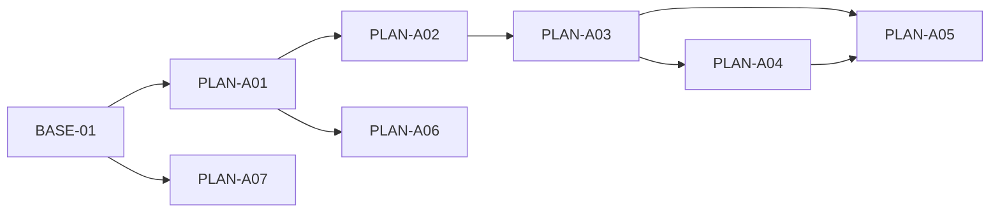
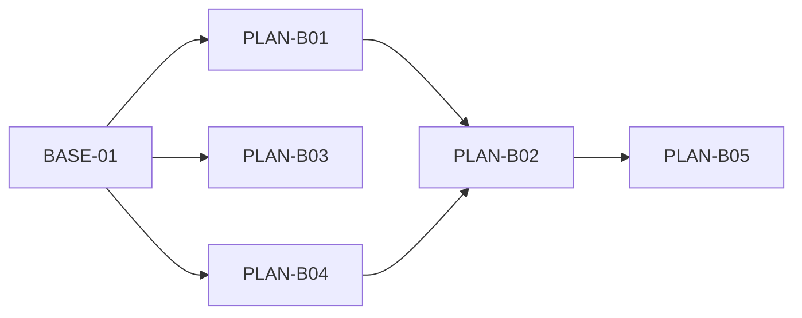
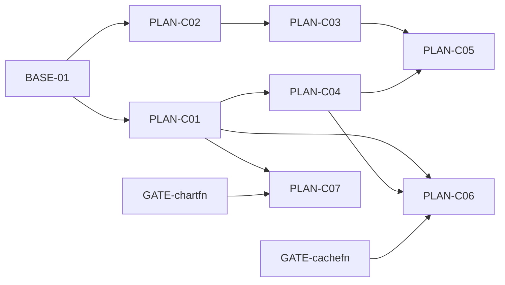
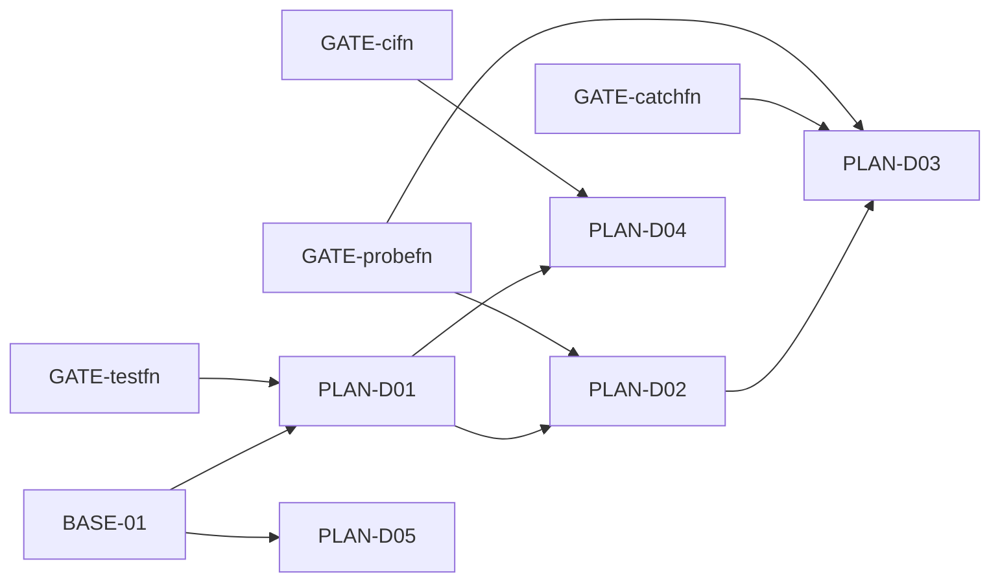
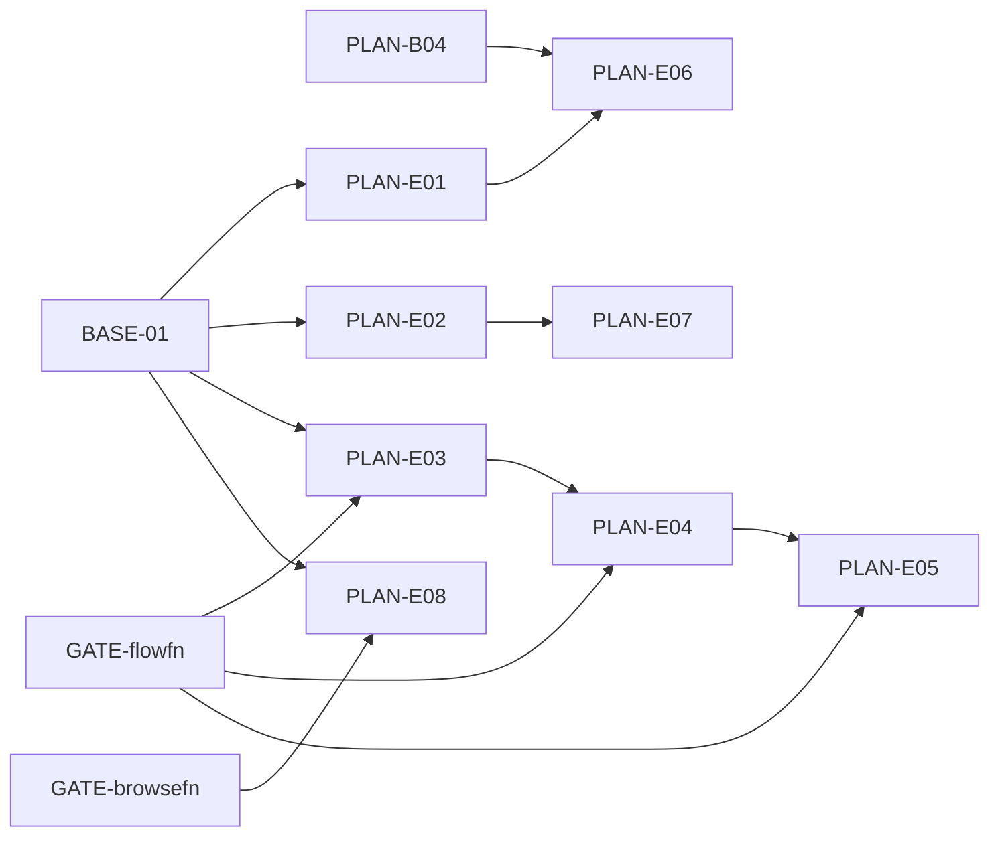
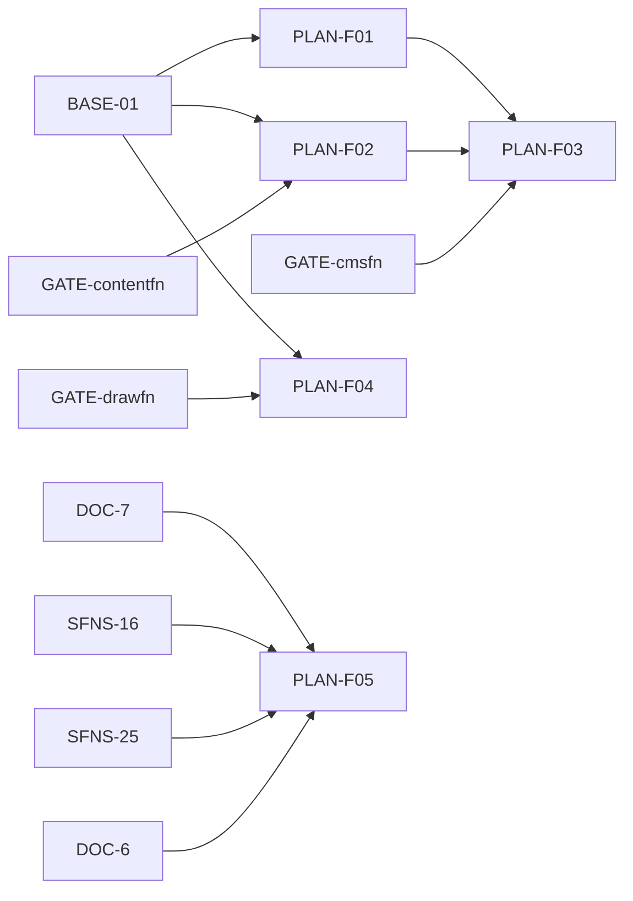
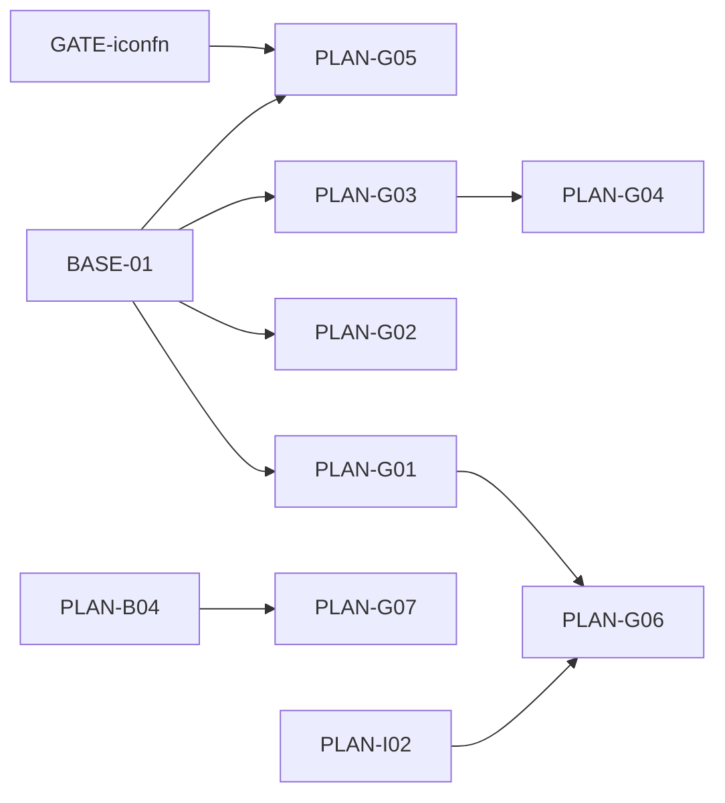
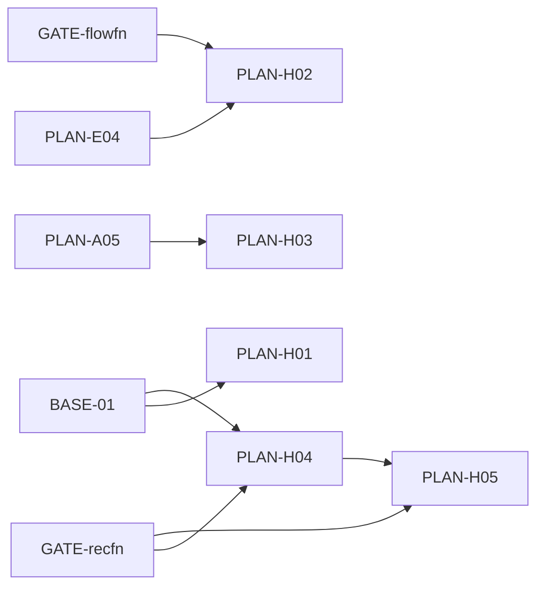
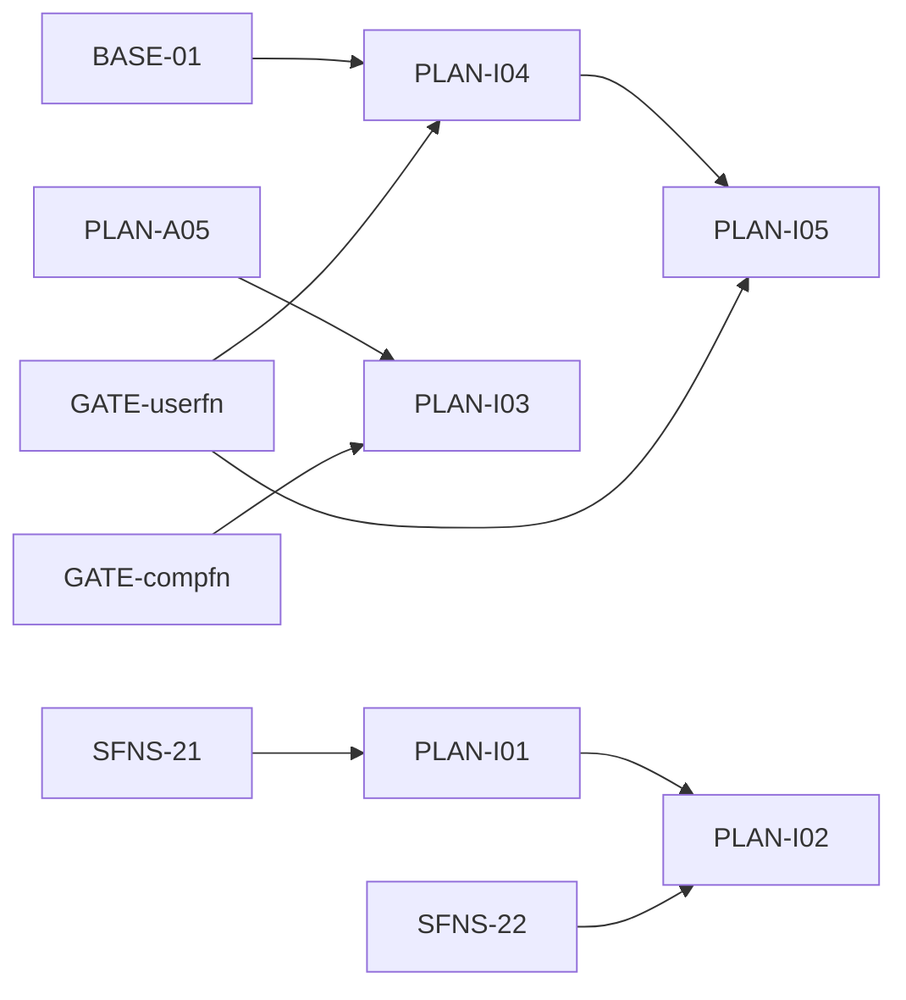

# Superfunctions enhancement backlog architecture

**Mode:** plan. **Account/workspace:** Composio Linear `21n`. **Date:** 23 October 2026.

## Decision summary

Create only distinct incremental work and reuse the established delivery families. The first useful wave is scoped delegated action authority, source-backed memory evidence, per-attempt inference receipts, and stale-edit protection on capabilities already on dev. Later function enhancements remain conditional on their named ports/decisions. No function migration is implied by its presence in the earlier research.

This plan contains **9 outcome containers**, **54 PR-sized implementation drafts**, **37 independent boundary acceptance drafts**, **9 owner completion gates**, **9 non-dispatched hardening buckets**, and **one owner provisioning container** with **19 independently verifiable resource items**. BASE-01 is a separate baseline decision gate. **15 absent-function decisions** are records, not giant executable migration tickets; three other absent-function prerequisites already have existing issues. All PLAN-* handles are local aliases, not Linear issue IDs.

**No Linear issue, comment, document, relation, assignment, priority, estimate, queue configuration or code was changed.** Existing discussions, active PR contracts and current queue order are preserved.

## Target base and delivery constraints

Both inspected delivery configurations use `origin/dev`. The live GitHub dev head and local remote-tracking ref matched **`9205cbd3ac4372c5964acae1c41622d3dee8a707`**. The research checkout remains on `next` at **`523c66ae8cf981ff8331d56386cec1f81c704182`**. These are different source states.

Exactly **18 of the 38 researched areas are absent from dev**: `browsefn`, `cachefn`, `catchfn`, `chartfn`, `cifn`, `cmsfn`, `compfn`, `contentfn`, `docsfn`, `drawfn`, `flowfn`, `iconfn`, `logfn`, `probefn`, `recfn`, `testfn`, `userfn`, `watchfn`. DocsFn has an open engine PR/roadmap; LogFn and WatchFn already have narrow port issues. The other absent areas need an explicit bounded port plan, deferral, or a different-base decision before their enhancement can execute.

**BASE-01 is not green.** The dev JavaScript check passed, but the analysis gate failed with 50 Security Hotspots, 5.6% duplication on new code, D reliability and E security ratings. This is pre-existing base evidence, not a new-feature regression. [SFNS-28](https://linear.app/21n/issue/SFNS-28/upgrade-vitest-monorepo-wide-to-clear-the-pr-241-advisories) and [DEV-34](https://linear.app/21n/issue/DEV-34/fix-devfnadmin-timing-flakes-in-the-full-javascript-ci-plan) are separate dependency/flake items and do not prove these analysis conditions resolved. Confirm a bounded remediation or explicit gate policy and refresh exact-head results before queue intake.

No implementation draft is labeled dispatch-ready while the base gate and publication decisions remain unresolved. “Needs decision” is used honestly rather than treating a bounded description as proof of all prerequisites. No stacked PRs are proposed: merge real prerequisites into dev and rebase each child on that merged contract.

## Existing work to reuse

| Existing family | Live status and proposed treatment |
| --- | --- |
| [SFNS-15](https://linear.app/21n/issue/SFNS-15/deliver-a-shared-api-contract-with-generated-sdk-releases-agent-tools) | Keep the shared API/SDK/release/tool/feedback outcome and its children. [SFNS-16](https://linear.app/21n/issue/SFNS-16/define-a-shared-versioned-api-operation-and-release-contract) is Done; [SFNS-17](https://linear.app/21n/issue/SFNS-17/generate-installable-typescript-sdks-through-deterministic-apifn-build) is In Review with PR #254. Reuse [SFNS-18](https://linear.app/21n/issue/SFNS-18/generate-installable-python-sdks-from-the-apifn-operation-contract)–[SFNS-26](https://linear.app/21n/issue/SFNS-26/qualify-integrated-api-sdks-executable-tools-and-sdk-failure-feedback), [MCP-5](https://linear.app/21n/issue/MCP-5/expose-explicitly-selected-openapi-operations-as-executable-mcpfn) and [SFNS-30](https://linear.app/21n/issue/SFNS-30/declare-server-idempotency-in-the-operation-catalog-so-sdks-can-retry) for their existing scopes. |
| [DOC-1](https://linear.app/21n/issue/DOC-1/make-docsfn-a-complete-publishing-toolchain-for-standalone-and) | Keep DOC-1–10 and current PR #133. Existing docs publication, source composition, public agent outputs and reader MCP are not new tickets here. PLAN-F05 is only a later source-revision freshness candidate. |
| [PLUG-1](https://linear.app/21n/issue/PLUG-1/make-plugfn-production-ready-for-fellotron-class-consumers) | Keep platform capability, persistence, provider and release work. PLAN-A02–A05 are proposed agent-grant-specific children under this existing parent, subject to the reuse decision. |
| [SFO-39](https://linear.app/21n/issue/SFO-39/authfn-access-plugin) / [SFO-40](https://linear.app/21n/issue/SFO-40/userfn-init) | Preserve access-policy orchestration and user/cohort/config ownership. PLAN-I04/I05 would be bounded children under the existing user outcome; PLAN-A01 does not replace session gating. |
| [SFO-44](https://linear.app/21n/issue/SFO-44/extfn-v020) | Preserve the extension platform outcome. PLAN-G02 is a proposed bounded recipe child, not another platform rewrite. |
| [SFN-16](https://linear.app/21n/issue/SFN-16/make-secfn-production-ready) | Still In Progress. Preserve its security scope; historical completion prose does not justify rewriting the active contract. New scanner scope requires ownership/scope reconciliation. |
| [DEV-18](https://linear.app/21n/issue/DEV-18/make-devfn-runtimes-observable-and-safely-operable-by-coding-agents) | Preserve existing runtime diagnostics/grant/recovery work. This plan does not rebuild DevFn or add it to the research function inventory. |

Canonical live issue IDs matter: several older descriptions still refer to prior SFNS aliases for the DocsFn family. The table uses the current DOC identifiers returned by Linear and preserves their underlying identities.

## Current PR boundaries

| PR | Frozen head | Scope treatment |
| --- | --- | --- |
| [#257](https://github.com/21nCo/superfunctions/pull/257) | `89cae9df462f2f7b03115d400b878223d68c3092` | TypeScript SES attempt/timeout/shutdown and uncertain delivery are existing work; preserve them. |
| [#256](https://github.com/21nCo/superfunctions/pull/256) | `15a181c787d4506115a40d87b12d2d3f2563b627` | Python SES cancellation/transport lifetime is existing work; new scheduling follows its disposition. |
| [#254](https://github.com/21nCo/superfunctions/pull/254) | `adeafd22fed294146913166250999aebab2084da` | SFNS-17 TypeScript SDK delivery is active; do not rewrite it. Declared write-idempotency behavior is separately tracked by SFNS-30. |
| [#248](https://github.com/21nCo/superfunctions/pull/248) | `43c9437001160856a7ef8e322a3ffb6cec37d78f` | Shared database codecs/query behavior is active; do not duplicate or assume merge. |
| [#244](https://github.com/21nCo/superfunctions/pull/244) | `19c38aa34c6cce3f830d9d21d681ac16bb111a75` | McpFn dependency/schema-pointer work is active; rebase before touching adjacent contracts. |
| [#206](https://github.com/21nCo/superfunctions/pull/206) | `a44402b3e47a410316720107721201fbcf1e36a1` | Existing ApiFn/DocsFn consumer site; preserve its integration scope. |
| [#133](https://github.com/21nCo/superfunctions/pull/133) | `a7722fdddfc8bcd9dbb4cfd884564984e75b2305` | DocsFn engine/publishing baseline. Retrieved all 838 file metadata entries (581 under docsfn); this was scope inspection, not a full code review of all files. |

## Outcome containers

| Draft | Outcome | Completion gate |
| --- | --- | --- |
| PLAN-A | Controlled delegated tool execution: `authfn`, `plugfn`, `secfn`, `mcpfn` | PLAN-QA-OWNER-A |
| PLAN-B | Source-backed memory and retrieval: `memoryfn`, `searchfn`, `filefn` | PLAN-QA-OWNER-B |
| PLAN-C | Accountable inference and usage budgets: `langfn`, `billfn`, `cachefn`, `chartfn` | PLAN-QA-OWNER-C |
| PLAN-D | Revision-bound runtime acceptance evidence: `testfn`, `probefn`, `catchfn`, `cifn` | PLAN-QA-OWNER-D |
| PLAN-E | Verifiable data and workflow recovery: `datafn`, `flowfn`, `hostfn`, `browsefn` | PLAN-QA-OWNER-E |
| PLAN-F | Revision-bound authoring and content drafts: `mdfn`, `contentfn`, `cmsfn`, `drawfn`, `docsfn`, `apifn` | PLAN-QA-OWNER-F |
| PLAN-G | Inspectable developer and operator interfaces: `clifn`, `extfn`, `uifn`, `iconfn`, `superconsole` | PLAN-QA-OWNER-G |
| PLAN-H | Complete communication and recording journeys: `mailfn`, `sendfn`, `botfn`, `recfn` | PLAN-QA-OWNER-H |
| PLAN-I | Correlated operations and measured product changes: `logfn`, `watchfn`, `compfn`, `userfn` | PLAN-QA-OWNER-I |

Parents are containers and are never dispatched as implementation cards. A functional existing parent can own a new child while the cross-function outcome links to it through real prerequisites and its final gate. Hardening buckets are related to parents, not automatically queued completion blockers.

## Ordered implementation table

Presentation below is a topological order within each workstream. Independent work can proceed only against merged prerequisite interfaces and disjoint owned paths. Size is **non-test / total lines** and includes generated artifacts, schema fixtures and lockfile churn. No Linear estimate/priority field is set.

| Draft / parent | Outcome | Required dependencies | Parallelism / owned subsystems | Size | Readiness | Verification / external acceptance |
| --- | --- | --- | --- | --- | --- | --- |
| PLAN-A01 parent PLAN-A | Bind authenticated service actors to a delegated-action context | BASE-01 | After merged prerequisites; authfn. Shared-file lanes below apply. | 650 / 1,500 | needs decision: BASE-01 | Local unit/integration/contracts; PLAN-QA-A-PROVIDER owns external evidence. |
| PLAN-A02 parent PLUG-1 | Persist versioned delegated connection grants | PLAN-A01 | After merged prerequisites; plugfn. Shared-file lanes below apply. | 700 / 1,600 | needs decision: BASE-01 | Local unit/integration/contracts; PLAN-QA-A-DB owns external evidence. |
| PLAN-A03 parent PLUG-1 | Evaluate delegated grants against current scope and revocation | PLAN-A02 | After merged prerequisites; plugfn. Shared-file lanes below apply. | 850 / 1,900 | needs decision: BASE-01 | Local unit/integration/contracts; PLAN-QA-A-DB, PLAN-QA-A-PROVIDER owns external evidence. |
| PLAN-A04 parent PLUG-1 | Enforce atomic per-grant action limits | PLAN-A03 | After merged prerequisites; plugfn. Shared-file lanes below apply. | 850 / 2,100 | needs decision: BASE-01 | Local unit/integration/contracts; PLAN-QA-A-DB owns external evidence. |
| PLAN-A05 parent PLUG-1 | Apply delegated policy at provider action dispatch | PLAN-A03, PLAN-A04 | After merged prerequisites; plugfn. Shared-file lanes below apply. | 1,000 / 2,300 | needs decision: BASE-01 | Local unit/integration/contracts; PLAN-QA-A-PROVIDER owns external evidence. |
| PLAN-A06 parent PLAN-A | Bind optional tool approvals to the canonical manifest revision | PLAN-A01 | After merged prerequisites; mcpfn. Shared-file lanes below apply. | 950 / 2,200 | needs decision: BASE-01 | Local unit/integration/contracts; PLAN-QA-MCP-HOST owns external evidence. |
| PLAN-A07 parent PLAN-A | Scan bounded agent transcript and tool-result formats without leaking matches | BASE-01 | After merged prerequisites; secfn. Shared-file lanes below apply. | 900 / 2,200 | needs decision: BASE-01 | Local unit/integration/contracts; PLAN-QA-A-PRIVACY owns external evidence. |
| PLAN-B01 parent PLAN-B | Bind stored memories to revisioned source evidence | BASE-01 | After merged prerequisites; memoryfn. Shared-file lanes below apply. | 750 / 1,700 | needs decision: BASE-01 | Local unit/integration/contracts; PLAN-QA-B-DB owns external evidence. |
| PLAN-B02 parent PLAN-B | Return stale and unavailable evidence states during memory retrieval | PLAN-B01, PLAN-B04 | After merged prerequisites; memoryfn. Shared-file lanes below apply. | 1,000 / 2,300 | needs decision: BASE-01 | Local unit/integration/contracts; PLAN-QA-B-DB owns external evidence. |
| PLAN-B03 parent PLAN-B | Expose optional source spans and revisions through search results | BASE-01 | After merged prerequisites; searchfn. Shared-file lanes below apply. | 700 / 1,600 | needs decision: BASE-01 | Local unit/integration/contracts; PLAN-QA-B-DB owns external evidence. |
| PLAN-B04 parent PLAN-B | Resolve immutable file evidence references under current grants | BASE-01 | After merged prerequisites; filefn. Shared-file lanes below apply. | 700 / 1,600 | needs decision: BASE-01 | Local unit/integration/contracts; PLAN-QA-B-FILES owns external evidence. |
| PLAN-B05 parent PLAN-B | Promote reusable procedures only from matching executed evidence | PLAN-B02 | After merged prerequisites; memoryfn. Shared-file lanes below apply. | 800 / 1,800 | needs decision: BASE-01 | Local unit/integration/contracts; PLAN-QA-B-QUALITY owns external evidence. |
| PLAN-C01 parent PLAN-C | Normalize per-attempt inference usage and cost receipts | BASE-01 | After merged prerequisites; langfn. Shared-file lanes below apply. | 650 / 1,500 | needs decision: BASE-01 | Local unit/integration/contracts; PLAN-QA-MODEL owns external evidence. |
| PLAN-C02 parent PLAN-C | Add an additive usage-reservation ledger | BASE-01 | After merged prerequisites; billfn. Shared-file lanes below apply. | 600 / 1,400 | needs decision: BASE-01 | Local unit/integration/contracts; PLAN-QA-C-DB owns external evidence. |
| PLAN-C03 parent PLAN-C | Commit or release usage reservations atomically | PLAN-C02 | After merged prerequisites; billfn. Shared-file lanes below apply. | 1,100 / 2,500 | needs decision: BASE-01 | Local unit/integration/contracts; PLAN-QA-C-DB owns external evidence. |
| PLAN-C04 parent PLAN-C | Route inference within an explicit attempt and cost budget | PLAN-C01 | After merged prerequisites; langfn. Shared-file lanes below apply. | 950 / 2,200 | needs decision: BASE-01 | Local unit/integration/contracts; PLAN-QA-MODEL owns external evidence. |
| PLAN-C05 parent PLAN-C | Compose inference attempts with billing reservations | PLAN-C03, PLAN-C04 | After merged prerequisites; langfn, billfn. Shared-file lanes below apply. | 750 / 1,800 | needs decision: BASE-01 | Local unit/integration/contracts; PLAN-QA-MODEL, PLAN-QA-C-DB owns external evidence. |
| PLAN-C06 parent PLAN-C | Add an opt-in semantic-cache admission and identity contract | PLAN-C01, PLAN-C04, GATE-cachefn | After merged prerequisites; cachefn, langfn. Shared-file lanes below apply. | 950 / 2,200 | needs decision: BASE-01; absent-function prerequisite | Local unit/integration/contracts; PLAN-QA-CACHE-EVAL owns external evidence. |
| PLAN-C07 parent PLAN-C | Provide validated execution-cost chart presets through the existing adapter | PLAN-C01, GATE-chartfn | After merged prerequisites; chartfn. Shared-file lanes below apply. | 450 / 1,000 | needs decision: BASE-01; absent-function prerequisite | Local unit/integration/contracts; PLAN-QA-CHART-VISUAL owns external evidence. |
| PLAN-D01 parent PLAN-D | Bind declared requirements to exact-revision test receipts | BASE-01, GATE-testfn | After merged prerequisites; testfn. Shared-file lanes below apply. | 1,100 / 2,500 | needs decision: BASE-01; absent-function prerequisite | Local unit/integration/contracts; PLAN-QA-D-RUNTIME owns external evidence. |
| PLAN-D02 parent PLAN-D | Export editable browser reproductions from captured evidence | PLAN-D01, GATE-probefn | After merged prerequisites; probefn. Shared-file lanes below apply. | 1,000 / 2,300 | needs decision: BASE-01; absent-function prerequisite | Local unit/integration/contracts; PLAN-QA-D-BROWSER owns external evidence. |
| PLAN-D03 parent PLAN-D | Link bug reports to a bounded reproduction task | PLAN-D02, GATE-catchfn, GATE-probefn | After merged prerequisites; catchfn, probefn. Shared-file lanes below apply. | 850 / 1,900 | needs decision: BASE-01; absent-function prerequisite | Local unit/integration/contracts; PLAN-QA-D-BROWSER owns external evidence. |
| PLAN-D04 parent PLAN-D | Prevent superseded CI revisions from claiming promotion | PLAN-D01, GATE-cifn | After merged prerequisites; cifn. Shared-file lanes below apply. | 1,000 / 2,300 | needs decision: BASE-01; absent-function prerequisite | Local unit/integration/contracts; PLAN-QA-D-RUNNER owns external evidence. |
| PLAN-D05 parent PLAN-D | Assert required tool selection from observed client-run traces | BASE-01 | After merged prerequisites; mcpfn. Shared-file lanes below apply. | 700 / 1,600 | needs decision: BASE-01 | Local unit/integration/contracts; PLAN-QA-MCP-HOST owns external evidence. |
| PLAN-E01 parent PLAN-E | Emit post-sync integrity receipts from existing reconciliation | BASE-01 | After merged prerequisites; datafn. Shared-file lanes below apply. | 850 / 1,900 | needs decision: BASE-01 | Local unit/integration/contracts; PLAN-QA-E-DATA owns external evidence. |
| PLAN-E02 parent PLAN-E | Bind deployment plans to exact target and revision | BASE-01 | After merged prerequisites; hostfn. Shared-file lanes below apply. | 900 / 2,100 | needs decision: BASE-01 | Local unit/integration/contracts; PLAN-QA-HOST owns external evidence. |
| PLAN-E03 parent PLAN-E | Persist explicit durable-effect checkpoints | BASE-01, GATE-flowfn | After merged prerequisites; flowfn. Shared-file lanes below apply. | 750 / 1,800 | needs decision: BASE-01; absent-function prerequisite | Local unit/integration/contracts; PLAN-QA-FLOW-DB owns external evidence. |
| PLAN-E04 parent PLAN-E | Resume durable effects without replaying committed side effects | PLAN-E03, GATE-flowfn | After merged prerequisites; flowfn. Shared-file lanes below apply. | 1,200 / 2,700 | needs decision: BASE-01; absent-function prerequisite | Local unit/integration/contracts; PLAN-QA-FLOW-DB owns external evidence. |
| PLAN-E05 parent PLAN-E | Prove recovery at a closed set of effect boundaries | PLAN-E04, GATE-flowfn | After merged prerequisites; flowfn. Shared-file lanes below apply. | 450 / 1,200 | needs decision: BASE-01; absent-function prerequisite | Local unit/integration/contracts; PLAN-QA-FLOW-DB owns external evidence. |
| PLAN-E06 parent PLAN-E | Restore a scoped data-and-file fixture with verification receipts | PLAN-E01, PLAN-B04 | After merged prerequisites; datafn, filefn. Shared-file lanes below apply. | 1,100 / 2,600 | needs decision: BASE-01 | Local unit/integration/contracts; PLAN-QA-RECOVERY owns external evidence. |
| PLAN-E07 parent PLAN-E | Own preview-environment resource leases and cleanup | PLAN-E02 | After merged prerequisites; hostfn. Shared-file lanes below apply. | 1,000 / 2,300 | needs decision: BASE-01 | Local unit/integration/contracts; PLAN-QA-HOST owns external evidence. |
| PLAN-E08 parent PLAN-E | Normalize retrieval evidence and extraction failures across providers | BASE-01, GATE-browsefn | After merged prerequisites; browsefn. Shared-file lanes below apply. | 850 / 1,900 | needs decision: BASE-01; absent-function prerequisite | Local unit/integration/contracts; PLAN-QA-WEB owns external evidence. |
| PLAN-F01 parent PLAN-F | Reject stale AI edit proposals using the current source revision | BASE-01 | After merged prerequisites; mdfn. Shared-file lanes below apply. | 350 / 850 | needs decision: BASE-01 | Local unit/integration/contracts; PLAN-QA-AUTHORING owns external evidence. |
| PLAN-F02 parent PLAN-F | Expose schema-derived content patch plans | BASE-01, GATE-contentfn | After merged prerequisites; contentfn. Shared-file lanes below apply. | 850 / 1,900 | needs decision: BASE-01; absent-function prerequisite | Local unit/integration/contracts; PLAN-QA-CONTENT owns external evidence. |
| PLAN-F03 parent PLAN-F | Provide schema-driven draft forms and scoped publish previews | PLAN-F01, PLAN-F02, GATE-cmsfn | After merged prerequisites; cmsfn, mdfn. Shared-file lanes below apply. | 1,100 / 2,500 | needs decision: BASE-01; absent-function prerequisite | Local unit/integration/contracts; PLAN-QA-CONTENT, PLAN-QA-AUTHORING owns external evidence. |
| PLAN-F04 parent PLAN-F | Apply reversible structured diagram changes with source references | BASE-01, GATE-drawfn | After merged prerequisites; drawfn. Shared-file lanes below apply. | 850 / 1,900 | needs decision: BASE-01; absent-function prerequisite | Local unit/integration/contracts; PLAN-QA-DIAGRAM owns external evidence. |
| PLAN-F05 parent DOC-1 | Mark documentation stale when its declared API/source revision changes | DOC-7, SFNS-16, SFNS-25, DOC-6 | After merged prerequisites; docsfn. Shared-file lanes below apply. | 700 / 1,600 | needs decision: BASE-01 | Local unit/integration/contracts; PLAN-QA-DOCS owns external evidence. |
| PLAN-G01 parent PLAN-G | Standardize scoped command plans and dry-run output | BASE-01 | After merged prerequisites; clifn. Shared-file lanes below apply. | 650 / 1,500 | needs decision: BASE-01 | Local unit/integration/contracts; PLAN-QA-CLI owns external evidence. |
| PLAN-G02 parent SFO-44 | Publish bounded page-context capture and sidepanel extension recipes | BASE-01 | After merged prerequisites; extfn. Shared-file lanes below apply. | 800 / 1,800 | needs decision: BASE-01 | Local unit/integration/contracts; PLAN-QA-EXTENSION owns external evidence. |
| PLAN-G03 parent PLAN-G | Define experimental agent-run interaction states | BASE-01 | After merged prerequisites; uifn. Shared-file lanes below apply. | 500 / 1,200 | needs decision: BASE-01 | Local unit/integration/contracts; PLAN-QA-UI-BROWSER, PLAN-QA-A11Y-MAC, PLAN-QA-A11Y-WINDOWS owns external evidence. |
| PLAN-G04 parent PLAN-G | Bind agent-run patterns consistently across supported frameworks | PLAN-G03 | After merged prerequisites; uifn. Shared-file lanes below apply. | 1,000 / 2,300 | needs decision: BASE-01 | Local unit/integration/contracts; PLAN-QA-UI-BROWSER, PLAN-QA-A11Y-MAC, PLAN-QA-A11Y-WINDOWS owns external evidence. |
| PLAN-G05 parent PLAN-G | Resolve semantic icon aliases through a thin catalog adapter | BASE-01, GATE-iconfn | After merged prerequisites; iconfn. Shared-file lanes below apply. | 300 / 700 | needs decision: BASE-01; absent-function prerequisite | Local unit/integration/contracts; PLAN-QA-ICON owns external evidence. |
| PLAN-G06 parent PLAN-G | Project an attention inbox from configured operator capabilities | PLAN-G01, PLAN-I02 | After merged prerequisites; superconsole, packages/admin. Shared-file lanes below apply. | 800 / 1,800 | needs decision: BASE-01 | Local unit/integration/contracts; PLAN-QA-CONSOLE owns external evidence. |
| PLAN-G07 parent PLAN-G | Extend existing upload patterns with verified processing states | PLAN-B04 | After merged prerequisites; uifn, filefn. Shared-file lanes below apply. | 650 / 1,500 | needs decision: BASE-01 | Local unit/integration/contracts; PLAN-QA-UI-BROWSER, PLAN-QA-B-FILES owns external evidence. |
| PLAN-H01 parent PLAN-H | Package a scoped inbox-to-reply starter using existing composition | BASE-01 | After merged prerequisites; mailfn, sendfn. Shared-file lanes below apply. | 650 / 1,500 | needs decision: BASE-01 | Local unit/integration/contracts; PLAN-QA-MAIL-DNS, PLAN-QA-MAIL-DELIVERY owns external evidence. |
| PLAN-H02 parent PLAN-H | Reserve transactional delivery capacity through the durable scheduler | PLAN-E04, GATE-flowfn | After merged prerequisites; sendfn, flowfn. Shared-file lanes below apply. | 1,000 / 2,300 | needs decision: BASE-01; absent-function prerequisite | Local unit/integration/contracts; PLAN-QA-MAIL-DELIVERY owns external evidence. |
| PLAN-H03 parent PLAN-H | Provide typed bot event recipes with deterministic replay | PLAN-A05 | After merged prerequisites; botfn. Shared-file lanes below apply. | 750 / 1,700 | needs decision: BASE-01 | Local unit/integration/contracts; PLAN-QA-BOT owns external evidence. |
| PLAN-H04 parent PLAN-H | Attach capability and source-span evidence to transcription results | BASE-01, GATE-recfn | After merged prerequisites; recfn. Shared-file lanes below apply. | 850 / 1,900 | needs decision: BASE-01; absent-function prerequisite | Local unit/integration/contracts; PLAN-QA-RECORDING owns external evidence. |
| PLAN-H05 parent PLAN-H | Make local recording mode explicit on the supported Mac path | PLAN-H04, GATE-recfn | After merged prerequisites; recfn. Shared-file lanes below apply. | 1,100 / 2,600 | needs decision: BASE-01; absent-function prerequisite | Local unit/integration/contracts; PLAN-QA-RECORDING owns external evidence. |
| PLAN-I01 parent PLAN-I | Propagate workflow, release and tool-call correlation through LogFn | SFNS-21 | After merged prerequisites; logfn. Shared-file lanes below apply. | 750 / 1,700 | needs decision: BASE-01 | Local unit/integration/contracts; PLAN-QA-OPERATIONS owns external evidence. |
| PLAN-I02 parent PLAN-I | Build a read-only incident evidence projection | PLAN-I01, SFNS-22 | After merged prerequisites; watchfn. Shared-file lanes below apply. | 850 / 1,900 | needs decision: BASE-01 | Local unit/integration/contracts; PLAN-QA-OPERATIONS owns external evidence. |
| PLAN-I03 parent PLAN-I | Collect revisioned compliance evidence through scoped integrations | PLAN-A05, GATE-compfn | After merged prerequisites; compfn, plugfn. Shared-file lanes below apply. | 950 / 2,200 | needs decision: BASE-01; absent-function prerequisite | Local unit/integration/contracts; PLAN-QA-COMPLIANCE owns external evidence. |
| PLAN-I04 parent SFO-40 | Record stable experiment exposure and holdout assignments | BASE-01, GATE-userfn | After merged prerequisites; userfn. Shared-file lanes below apply. | 850 / 1,900 | needs decision: BASE-01; absent-function prerequisite | Local unit/integration/contracts; PLAN-QA-EXPERIMENT owns external evidence. |
| PLAN-I05 parent SFO-40 | Report rollout guardrail breaches without claiming causality | PLAN-I04, GATE-userfn | After merged prerequisites; userfn. Shared-file lanes below apply. | 750 / 1,700 | needs decision: BASE-01; absent-function prerequisite | Local unit/integration/contracts; PLAN-QA-EXPERIMENT owns external evidence. |

## Dependency DAGs

Edges below are real prerequisite relationships from earlier issues to consumers. Parent/child hierarchy and preferred presentation order are omitted. GATE nodes are unresolved prerequisite decisions, not executable work. Existing issue dependencies are retained in the machine-readable plan; the diagram does not rewrite them.

### Workstream A

### Workstream B

### Workstream C

### Workstream D

### Workstream E

### Workstream F

### Workstream G

### Workstream H

### Workstream I

## Shared-file scheduling and integration

- Serialize root workspace/lockfile integration; broad cross-function port commits are not parallel feature work.
- PlugFn schema → evaluator → atomic admission → action-dispatch work is already sequenced by real contracts.
- UIFn agent-model, bindings and upload extensions share experimental export/fixture paths: schedule PLAN-G03 → PLAN-G04 → PLAN-G07 serially where those paths overlap. This is a scheduling constraint, not a fabricated semantic blocker.
- Keep memory schema → invalidation → promotion and billing schema → transitions → inference composition ordered.
- SendFn work waits for the disposition of PRs #256/#257 before editing transport-adjacent paths. The SDK work under SFNS-17 remains separately active.
- Integration occurs on the actual merged dev SHA. No frozen research commit is treated as the current deployment or package state.

## Acceptance boundaries and provisioning

Implementation issues accept only on code contracts, fixtures, local services and CI. Each detailed draft contains a named sentence deferring its external checks. Live acceptance is not folded into a single end card that blocks unrelated providers/devices.

| Acceptance alias | Checks | Blocked by implementation | Required owner resources | Readiness |
| --- | --- | --- | --- | --- |
| PLAN-QA-A-DB | Apply migrations to a fresh disposable PostgreSQL database and exercise revocation across two processes. Restart during last-slot admission; demonstrate no over-admission and retain database readback. | PLAN-A02, PLAN-A03, PLAN-A04 | database | needs access |
| PLAN-QA-A-PROVIDER | Using an explicit nonproduction read-only connection, execute one allowed read and show the exact principal/connection receipt. A denied mutation, expired grant and revoked grant fail before provider dispatch; no token appears in any output. | PLAN-A01, PLAN-A03, PLAN-A05 | provider-account | needs access |
| PLAN-QA-A-PRIVACY | Run the closed synthetic fixture set through the installed CLI and inspect redacted output. Unsupported formats are named; no claim of client interception or universal detection is made. | PLAN-A07 | owner-session | needs access |
| PLAN-QA-MCP-HOST | A configured installed client performs an allowed scenario; retain its actual tool-call transcript. A required-but-skipped tool is detected, and changing an approved declaration blocks the next call pending a new explicit approval. | PLAN-A06, PLAN-D05 | mcp-host | needs access |
| PLAN-QA-B-DB | Apply the additive memory migration, restart the service and retrieve the same scoped evidence. Change/delete a source and show stale/unavailable results plus preserved tombstone/scope enforcement. | PLAN-B01, PLAN-B02 | database | needs access |
| PLAN-QA-B-FILES | Upload a controlled document, capture a version reference, revoke its grant and confirm subsequent resolution is denied. Delete the test file/version and read the deletion back through the configured backend. | PLAN-B04 | file-storage | needs access |
| PLAN-QA-B-QUALITY | The owner provides at least one passing and one deliberately stale/failed procedure case. Inspect procedure/check/source revision bindings and confirm that no procedure runs automatically. | PLAN-B05 | evaluation-corpus | needs access |
| PLAN-QA-C-DB | Use two worker processes and restart between reservation/commit/release steps. Read back one terminal event per logical task and the reconciled balance; ambiguous outcomes remain unresolved until evidence arrives. | PLAN-C02, PLAN-C03, PLAN-C05 | database | needs access |
| PLAN-QA-MODEL | Run a fixed allowed task set with an explicitly configured nonproduction provider binding. Record attempts, cancellation, fallback, cost basis and budget exhaustion; compare receipts with provider-visible usage where available. | PLAN-C01, PLAN-C04, PLAN-C05 | model-account | needs access |
| PLAN-QA-CACHE-EVAL | Use a fixed owner-approved query/answer set including negation, amounts, corpus changes and cross-tenant lookalikes. Report incorrect reuse, quality checks, hit rate, latency and measured cost separately; leave the cache disabled until the owner accepts the tradeoff. | PLAN-C06 | evaluation-corpus, model-account | needs access |
| PLAN-QA-CHART-VISUAL | Inspect cost/latency units, unknown values and source labels in the supported bindings/export path. Confirm that no raw prompts or credentials appear in exports. | PLAN-C07 | owner-session | needs access |
| PLAN-QA-D-RUNTIME | Install the built package outside the monorepo and run the declared fixture runners on the merged revision. A missing assertion and a stale revision remain unverified even when unrelated tests pass. | PLAN-D01 | ci-runner | needs access |
| PLAN-QA-D-BROWSER | Capture a known controlled web regression and export an editable reproduction. Replay fails before the fix and passes after it; inspect locator ambiguity, viewport/profile context and redaction. | PLAN-D02, PLAN-D03 | browser-profile | needs access |
| PLAN-QA-D-RUNNER | Dispatch two controlled nonproduction revisions, supersede the first and retain runner/control-plane receipts. The stale run cannot claim promotion after restart or delayed completion. | PLAN-D04 | ci-runner | needs access |
| PLAN-QA-E-DATA | Inject a dropped record, duplicate mutation and changed field into a disposable two-sided sync fixture. The integrity receipt identifies each mismatch rather than trusting transport success. | PLAN-E01 | database | needs access |
| PLAN-QA-HOST | Create one registered nonproduction preview and record exact owned resources/lease. Fail the health gate, verify old traffic remains, and prove cleanup leaves unrelated resources intact with deletion readback. | PLAN-E02, PLAN-E07 | hosting-target | needs access |
| PLAN-QA-FLOW-DB | Run the closed kill/restart boundary set using real durable storage and controlled side effects. Read back committed effects, cancellation state and unresolved outcomes; do not generalize to untested providers. | PLAN-E03, PLAN-E04, PLAN-E05 | database | needs access |
| PLAN-QA-RECOVERY | Restore controlled records/files into a fresh registered target and verify references, digests and access scope. Interrupt once, reconcile/retry and retain cleanup/deletion receipts for all created targets and files. | PLAN-E06, PLAN-QA-E-DATA, PLAN-QA-B-FILES | database, file-storage | needs access |
| PLAN-QA-WEB | Read one controlled static page and one rendered page through the supported adapters. Challenge, missing field and changed source fixtures produce explicit failure/incomplete/diff evidence. | PLAN-E08 | web-fixture | needs access |
| PLAN-QA-AUTHORING | Make a concurrent human edit and confirm the old AI proposal is rejected. Accept a fresh proposal and inspect untouched source, sidecars and undo. | PLAN-F01 | browser-profile | needs access |
| PLAN-QA-CONTENT | Complete a small draft/edit/preview/publish journey in the registered test environment. A denied author, stale draft and invalid preview scope cannot publish. | PLAN-F02, PLAN-F03 | browser-profile | needs access |
| PLAN-QA-DIAGRAM | Apply a controlled scene delta and inspect stable IDs, untouched layout and source links. Undo and export/import retain the declared semantics. | PLAN-F04 | browser-profile | needs access |
| PLAN-QA-DOCS | After the existing publishing acceptance is available, change a referenced symbol/revision and inspect stale-page/example reporting. Confirm no duplicate reader, renderer or automatic content publication was introduced. | PLAN-F05, DOC-3 | browser-profile | needs access |
| PLAN-QA-CLI | Install a packed owning CLI in a clean directory and inspect one read plan and one explicitly non-executed mutation dry-run. Selected scope/effect and stable error codes are visible; JSON stdout parses and no secret enters the plan. | PLAN-G01 | owner-session | needs access |
| PLAN-QA-EXTENSION | Install the built recipe in registered Chromium and Firefox profiles and capture selected public context. Protected form fields, missing permissions and unsupported capabilities are handled as declared; remove the test extensions afterwards. | PLAN-G02 | browser-profile | needs access |
| PLAN-QA-UI-BROWSER | Run the same controlled event fixture in React, Svelte and Solid and inspect state, focus, error and reduced-motion behavior. Resume an interrupted upload; unavailable scan/processing capability remains visible. | PLAN-G03, PLAN-G04, PLAN-G07 | browser-profile | needs access |
| PLAN-QA-A11Y-MAC | On the registered Mac, exercise state announcements, focus order, pending/cancel states and reduced-motion presentation. Record actual assistive-technology output; browser emulation is not substituted. | PLAN-G03, PLAN-G04 | voiceover | needs access |
| PLAN-QA-A11Y-WINDOWS | On the registered Windows host, exercise the same state/focus tasks with NVDA. Record any deliberate unsupported combination and actual output; do not mark an unrun platform passed. | PLAN-G03, PLAN-G04 | nvda | needs access |
| PLAN-QA-CONSOLE | Populate the test console only from explicitly supplied adapters and follow one authoritative attention link. The same scoped permitted action/audit result is visible through the enabled projections; unregistered operations remain unavailable. | PLAN-G06 | browser-profile, mcp-host | needs access |
| PLAN-QA-MAIL-DNS | Register only the exact nonproduction subdomain, verify its DNS checks, receive controlled MIME and extract a test OTP. Remove created mailbox/domain/DNS resources and read back their deletion; retain no public-platform enablement. | PLAN-H01 | mail-domain | needs access |
| PLAN-QA-MAIL-DELIVERY | Use an approved provider sandbox and controlled recipients to exercise transactional traffic under broadcast saturation. A lost response remains uncertain and is reconciled before any retry/fallback; compare provider receipts and remove disposable sending identities/resources. | PLAN-H01, PLAN-H02 | email-sandbox | needs access |
| PLAN-QA-BOT | Use only the owner-allowlisted nonproduction channel/server to trigger one recipe. Replay the same event and show no duplicate external action; remove any test message/resource created by the run. | PLAN-H03 | bot-channel | needs access |
| PLAN-QA-RECORDING | Use consented sample audio on the registered Mac to start/stop recording and inspect mic/system-source indicators. Local-only mode sends no audio externally; verify timestamps, source revisions, permission failure and resource release. | PLAN-H04, PLAN-H05 | recording-host | needs access |
| PLAN-QA-OPERATIONS | Inject one controlled nonproduction failure with an exact release/workflow/tool identity and query persisted correlated evidence. Missing sources and unproved causal hypotheses remain explicit; no remediation runs. | PLAN-I01, PLAN-I02 | operations-stack | needs access |
| PLAN-QA-COMPLIANCE | Read only the declared repository/deployment evidence fields from the allowlisted nonproduction scope. Revoke access, confirm refresh stops, and inspect source/expiry linkage in an exported evidence pack. | PLAN-I03 | provider-account | needs access |
| PLAN-QA-EXPERIMENT | In a controlled cohort fixture, record exposures under two revisions and inspect observed outcomes and held-out assignments. Missing denominators or mismatched samples prevent an effectiveness claim; no automatic rollout/rollback occurs. | PLAN-I04, PLAN-I05 | experiment-store | needs access |
| PLAN-QA-ICON | Inspect the small declared alias set, accessible labels, fallback and source/license metadata on the selected adapter. No bespoke catalog or unverified license claim is introduced. | PLAN-G05 | owner-session | needs access |

Each boundary is blocked only by the PLAN-RESOURCE-* items it needs, never by the aggregate PLAN-PROVISION container. One unavailable account/device therefore cannot block acceptance that uses already-provisioned resources. Every run inventories its disposable resources, deletes what it created and reads deletion back; if it creates nothing, it records that. Owner acceptance gates list all implementation children and applicable acceptance aliases, and remain unqueued until their evidence exists.

### Owner provisioning issue

**PLAN-PROVISION** is a human-owned container with one PLAN-RESOURCE-* child per row. Each child can close independently; the container is not a global blocker. Register the nonproduction bindings below and verify them before queueing the corresponding acceptance issue. Proposed owner: the authenticated workspace user Aravind; no assignment was made. Register secrets only through the connection/secret store or ignored local settings, never in Linear.

| Resource key | Item and exact scope | Registration and usability evidence |
| --- | --- | --- |
| database | Disposable PostgreSQL application schema. 21n Railway workspace ee2c7f17-9766-47ce-9466-ff1fc2a204fa; explicit workspace-scoped binding | Composio Railway binding or ignored settings containing only a secret reference. Read version/current schema and run an isolated create/read/delete fixture; record database/schema identity and deletion. |
| provider-account | Read-only test provider connection. Explicit nonproduction repository/account owned by 21n; resolve its active Composio alias before use | Composio active alias plus provider/account/resource allowlist. Read current account identity and one allowlisted resource; verify denied scope without performing the forbidden action. |
| model-account | Nonproduction model-provider binding. Owner-selected provider/model/account with a finite spend cap | Existing secret manager/Composio binding, never a key in a ticket. Read account/model availability where supported, then a bounded owner-approved synthetic request; retain usage identity. |
| file-storage | Disposable file bucket or local storage namespace. Use 21n-dev account c801efc2879825babdb9b2534199c4dd for Cloudflare-backed resources; never production | Ignored binding with account ID, namespace and secret reference. Read storage identity, create/read/delete one controlled file and read back deletion. |
| evaluation-corpus | Owner-adjudicated controlled evaluation set. Synthetic or consented data with explicit source, expected behavior and allowed use | Versioned fixture manifest outside secrets/private logs. Validate manifest/digests and sample labels; record omissions and owner acceptance criteria. |
| browser-profile | Authorized test browser profile and test app. Dedicated non-Serro Chromium/Firefox/WebKit test profiles and a nonproduction app | Ignored local profile references and exact test URLs. Open the controlled app and confirm profile identity, scope and browser versions without modifying production. |
| mcp-host | Installed MCP host and local fixture server. Owner-selected installed host profile with a test server and no production tools | Ignored host-profile reference; exact client/runtime version and manifest digest. Discover the local fixture tools and retain host identity/transport/version; no unrelated connected account is used. |
| ci-runner | Approved nonproduction Linux CI/runner project. Current 21n repository and test-only runner binding | GitHub environment/runner scope or ignored test-runner config. Read runner identity/capabilities and availability; retain exact-head CI links. No coordinator starts during planning. |
| hosting-target | Disposable preview/deployment target. Explicit 21n nonproduction VPS/provider; Cloudflare resources use only 21n-dev | Ignored SSH/provider target reference with account/project IDs. Read target identity and current owned-resource inventory; prove the allowed namespace before creating a preview. |
| web-fixture | Controlled public retrieval pages. Owner-approved fixture domain or local test server | Exact URL allowlist and expected content digests. Read static/rendered pages and compare source digests; do not crawl unrelated sites. |
| owner-session | Owner-run installed artifact inspection. Owner’s explicitly chosen test machine | Installed artifact/version and a short manual checklist. Verify installed version/path and access to controlled fixtures; no real secret transcript is scanned. |
| voiceover | Mac assistive-technology session. Registered Mac with VoiceOver and a test browser | Host/OS/browser/VoiceOver versions. Verify screen reader is running and the controlled test page is accessible. |
| nvda | Windows assistive-technology session. Registered Windows host with NVDA and a test browser | Host/OS/browser/NVDA versions. Verify screen reader is running and the controlled test page is accessible. |
| mail-domain | Exact owned nonproduction mail subdomain. One explicit subdomain of 21n.dev, Cloudflare account c801efc2879825babdb9b2534199c4dd | Pinned account/zone/domain allowlist, mailbox binding and secret references. Read zone/domain identity and DNS records; retain exact created-record inventory for cleanup. |
| email-sandbox | Approved email-delivery sandbox and recipients. Owner-selected nonproduction provider/sandbox account; no production recipients | Ignored provider binding and explicit recipient allowlist. Read provider identity/region and sandbox restrictions, then an explicitly authorized controlled send during acceptance. |
| bot-channel | Exact test Slack/Discord destination. 21n workspace/server and owner-allowlisted nonproduction channel | Composio account alias plus channel/server ID. Read workspace/server/channel identity before any separately authorized test message. |
| recording-host | Mac, audio permissions and local model fixture. macOS 14+ Apple Silicon, consented sample audio and an owner-selected local ASR model | Ignored host/model references and consented fixture digests. Read host/model availability and permission status; no recording or model download occurs during planning. |
| operations-stack | Nonproduction durable event collector. Registered 21n application/collector/database environment | Ignored endpoint/store/account references. Read service identity/health and a seeded non-sensitive event without enabling collectors or remediation. |
| experiment-store | Controlled exposure/outcome dataset. Explicit tenant and test-only event-store/warehouse binding | Ignored store reference and fixed metric/cohort manifest. Read schema/metric version and a fixed synthetic cohort; no production rollout is changed. |

### Beta handoff

No Beta builds workflow or betaHandoff configuration was observed for these Superfunctions delivery configs. Do not invent targets, landing URLs or a beta handoff. Package publication remains separately scoped.

The existing tag/npm/Python/Swift release workflows are not by themselves a configured owner beta pipeline. If a beta pipeline is later selected, record actual target names, dev landing URLs, package names and the first owning version change before queueing. No download URL, beta version or handoff is fabricated here.

## Function-by-function coverage and baseline corrections

| Function | On dev? | Existing work | New aliases / prerequisite | Treatment |
| --- | --- | --- | --- | --- |
| `apifn` | yes | [SFNS-15](https://linear.app/21n/issue/SFNS-15/deliver-a-shared-api-contract-with-generated-sdk-releases-agent-tools), [SFNS-16](https://linear.app/21n/issue/SFNS-16/define-a-shared-versioned-api-operation-and-release-contract), [SFNS-17](https://linear.app/21n/issue/SFNS-17/generate-installable-typescript-sdks-through-deterministic-apifn-build), [SFNS-18](https://linear.app/21n/issue/SFNS-18/generate-installable-python-sdks-from-the-apifn-operation-contract), [SFNS-19](https://linear.app/21n/issue/SFNS-19/persist-reviewable-sdk-release-candidates-and-per-target-build), [SFNS-20](https://linear.app/21n/issue/SFNS-20/publish-approved-sdk-artifacts-with-registry-reconciliation-and), [SFNS-25](https://linear.app/21n/issue/SFNS-25/connect-apifn-release-artifacts-to-the-canonical-docsfn-provider), [SFNS-26](https://linear.app/21n/issue/SFNS-26/qualify-integrated-api-sdks-executable-tools-and-sdk-failure-feedback), [SFNS-30](https://linear.app/21n/issue/SFNS-30/declare-server-idempotency-in-the-operation-catalog-so-sdks-can-retry) | Reuse existing family | The shared contract is Done in SFNS-16; SDK generation, releases, executable tools and feedback are existing SFNS-15 children. SFNS-17 is In Review with PR #254. Reuse rather than create a second family. |
| `authfn` | yes | [AUTH-1](https://linear.app/21n/issue/AUTH-1/support-canonical-gateway-routing-in-authfn-multi-region), [AUTH-2](https://linear.app/21n/issue/AUTH-2/expose-placement-bound-auth-context-for-regional-application-data), [SFO-39](https://linear.app/21n/issue/SFO-39/authfn-access-plugin) | PLAN-A01 | dev already authenticates and revokes user/service API keys; preserve existing placement-grant semantics and the distinct SFO-39 session access-policy proposal. |
| `billfn` | yes | [SFO-15](https://linear.app/21n/issue/SFO-15/billfn-init) | PLAN-C02, PLAN-C03, PLAN-C05 | Incremental extension of an existing dev capability. |
| `botfn` | yes | No equivalent function-specific outcome found in the inspected backlog. | PLAN-H03 | Incremental extension of an existing dev capability. |
| `browsefn` | no | No equivalent function-specific outcome found in the inspected backlog. | PLAN-E08; prerequisite GATE-browsefn | Conditional enhancement; resolve the named existing port or absent-function decision first. |
| `cachefn` | no | No equivalent function-specific outcome found in the inspected backlog. | PLAN-C06; prerequisite GATE-cachefn | Conditional enhancement; resolve the named existing port or absent-function decision first. |
| `catchfn` | no | No equivalent function-specific outcome found in the inspected backlog. | PLAN-D03; prerequisite GATE-catchfn | Conditional enhancement; resolve the named existing port or absent-function decision first. |
| `chartfn` | no | No equivalent function-specific outcome found in the inspected backlog. | PLAN-C07; prerequisite GATE-chartfn | Conditional enhancement; resolve the named existing port or absent-function decision first. |
| `cifn` | no | No equivalent function-specific outcome found in the inspected backlog. | PLAN-D04; prerequisite GATE-cifn | Conditional enhancement; resolve the named existing port or absent-function decision first. |
| `clifn` | yes | No equivalent function-specific outcome found in the inspected backlog. | PLAN-G01 | Incremental extension of an existing dev capability. |
| `cmsfn` | no | No equivalent function-specific outcome found in the inspected backlog. | PLAN-F03; prerequisite GATE-cmsfn | Conditional enhancement; resolve the named existing port or absent-function decision first. |
| `compfn` | no | No equivalent function-specific outcome found in the inspected backlog. | PLAN-I03; prerequisite GATE-compfn | Conditional enhancement; resolve the named existing port or absent-function decision first. |
| `contentfn` | no | No equivalent function-specific outcome found in the inspected backlog. | PLAN-F02; prerequisite GATE-contentfn | Conditional enhancement; resolve the named existing port or absent-function decision first. |
| `datafn` | yes | [DATA-1](https://linear.app/21n/issue/DATA-1/add-tenant-placement-and-canonical-gateway-routing-to-datafn-multi), [DATA-2](https://linear.app/21n/issue/DATA-2/add-const-safe-field-builders-and-align-datafn-schema-inference), [DATA-3](https://linear.app/21n/issue/DATA-3/own-isancestorinactive-as-a-datafn-system-field), [DATA-4](https://linear.app/21n/issue/DATA-4/support-gateway-issued-direct-regional-sync-tickets), [DATA-5](https://linear.app/21n/issue/DATA-5/expose-canonical-namespace-storage-metadata-for-datafn-operations), [DATA-6](https://linear.app/21n/issue/DATA-6/expose-canonical-structural-resource-selector-extraction) | PLAN-E01, PLAN-E06 | Incremental extension of an existing dev capability. |
| `docsfn` | no | [DOC-1](https://linear.app/21n/issue/DOC-1/make-docsfn-a-complete-publishing-toolchain-for-standalone-and), [DOC-2](https://linear.app/21n/issue/DOC-2/compose-docsfn-content-providers-through-the-canonical-provider), [DOC-3](https://linear.app/21n/issue/DOC-3/qualify-docsfn-publishing-with-clean-installs-browsers-and-an-actual), [DOC-4](https://linear.app/21n/issue/DOC-4/package-complete-docsfn-site-routes-for-nextjs-and-sveltekit), [DOC-5](https://linear.app/21n/issue/DOC-5/initialize-and-run-standalone-docsfn-sites-through-the-cli), [DOC-6](https://linear.app/21n/issue/DOC-6/qualify-the-merged-docsfn-engine-baseline-on-dev-for-publishing), [DOC-7](https://linear.app/21n/issue/DOC-7/extract-a-shared-docsfn-site-runtime-with-consistent-build-snapshots), [DOC-8](https://linear.app/21n/issue/DOC-8/generate-public-llm-and-per-page-markdown-artifacts-during-docsfn-site), [DOC-9](https://linear.app/21n/issue/DOC-9/expose-docsfn-reader-search-and-page-access-through-mcpfn), [DOC-10](https://linear.app/21n/issue/DOC-10/add-a-revision-pinned-remote-repository-content-provider-for-docsfn), [SFNS-25](https://linear.app/21n/issue/SFNS-25/connect-apifn-release-artifacts-to-the-canonical-docsfn-provider) | PLAN-F05; prerequisite DOC-6 | Absent from dev; PR #133 and DOC-1–10 already own the engine qualification and publishing roadmap. Only revision-linked freshness is a distinct later candidate. |
| `drawfn` | no | No equivalent function-specific outcome found in the inspected backlog. | PLAN-F04; prerequisite GATE-drawfn | Conditional enhancement; resolve the named existing port or absent-function decision first. |
| `extfn` | yes | [SFO-44](https://linear.app/21n/issue/SFO-44/extfn-v020) | PLAN-G02 | Incremental extension of an existing dev capability. |
| `filefn` | yes | [SFO-14](https://linear.app/21n/issue/SFO-14/filefn-init), [SFO-23](https://linear.app/21n/issue/SFO-23/filefn-swift-client) | PLAN-B04, PLAN-E06, PLAN-G07 | Incremental extension of an existing dev capability. |
| `flowfn` | no | No equivalent function-specific outcome found in the inspected backlog. | PLAN-E03, PLAN-E04, PLAN-E05, PLAN-H02; prerequisite GATE-flowfn | Conditional enhancement; resolve the named existing port or absent-function decision first. |
| `hostfn` | yes | [SFO-17](https://linear.app/21n/issue/SFO-17/hostfn-bug-fixes) | PLAN-E02, PLAN-E07 | Incremental extension of an existing dev capability. |
| `iconfn` | no | No equivalent function-specific outcome found in the inspected backlog. | PLAN-G05; prerequisite GATE-iconfn | Conditional enhancement; resolve the named existing port or absent-function decision first. |
| `langfn` | yes | [SFNS-4](https://linear.app/21n/issue/SFNS-4/deliver-super-functions-upstream-capabilities-and-compatibility) | PLAN-C01, PLAN-C04, PLAN-C05, PLAN-C06 | dev adoption is TypeScript; normalized usage/cost fields and provider adapters already exist. Extend per-attempt receipts and explicit routing policy. Python is not present on this base. |
| `logfn` | no | [SFNS-21](https://linear.app/21n/issue/SFNS-21/port-and-qualify-the-reusable-logfn-event-pipeline-for-dev-telemetry), [SFNS-23](https://linear.app/21n/issue/SFNS-23/report-bounded-typescript-and-python-sdk-failures-without-changing-api) | PLAN-I01; prerequisite SFNS-21 | Absent from dev; SFNS-21 already owns a narrow TS/Python event-pipeline port. Correlation extension follows that contract. |
| `mailfn` | yes | [SFN-17](https://linear.app/21n/issue/SFN-17/build-mailfn-as-a-reusable-programmable-mailbox-function) | PLAN-H01 | dev already has inbox/wait/OTP/CLI/MCP and an outbound composition adapter. The proposal is a complete fixture-backed starter, not these primitives again. |
| `mcpfn` | yes | [MCP-1](https://linear.app/21n/issue/MCP-1/enable-transport-neutral-mcpfn-regression-and-conformance-testing), [MCP-2](https://linear.app/21n/issue/MCP-2/make-mcpfn-the-batteries-included-mcp-sdk-and-quality-platform), [MCP-3](https://linear.app/21n/issue/MCP-3/add-deterministic-client-profile-contracts-and-actionable-schema), [MCP-4](https://linear.app/21n/issue/MCP-4/make-mcpfn-cloudflare-worker-bundles-resilient-to-mixed-zod-entry), [MCP-5](https://linear.app/21n/issue/MCP-5/expose-explicitly-selected-openapi-operations-as-executable-mcpfn) | PLAN-A06, PLAN-D05 | Incremental extension of an existing dev capability. |
| `mdfn` | yes | [SFN-20](https://linear.app/21n/issue/SFN-20/build-mdfn-as-the-superfunctions-markdown-authoring-platform) | PLAN-F01, PLAN-F03 | dev already has range-validated AI edit conversion, suggestions and normal transactions. The incremental proposal is an expected source revision/hash check. |
| `memoryfn` | yes | [SFNS-4](https://linear.app/21n/issue/SFNS-4/deliver-super-functions-upstream-capabilities-and-compatibility) | PLAN-B01, PLAN-B02, PLAN-B05 | dev already has explicit scoped storage, additive lifecycle migrations, update/forget/tombstone handling, source-authority caveats and contradiction/update relationship types. Only evidence identity/validity and later procedure eligibility are proposed. |
| `plugfn` | yes | [PLUG-1](https://linear.app/21n/issue/PLUG-1/make-plugfn-production-ready-for-fellotron-class-consumers), [SFO-36](https://linear.app/21n/issue/SFO-36/plugfn-managed-persistence-datafn-persistence-docs), [SFNS-4](https://linear.app/21n/issue/SFNS-4/deliver-super-functions-upstream-capabilities-and-compatibility) | PLAN-A02, PLAN-A03, PLAN-A04, PLAN-A05, PLAN-I03 | dev already has actor-aware connection selection, an authorization hook, delegated owner/grant types, provider scope checks, internal credential use and refresh-time reauthorization. Versioned per-agent grants/limits are the proposed extension; general platform work stays in PLUG-1. |
| `probefn` | no | No equivalent function-specific outcome found in the inspected backlog. | PLAN-D02, PLAN-D03; prerequisite GATE-probefn | Conditional enhancement; resolve the named existing port or absent-function decision first. |
| `recfn` | no | No equivalent function-specific outcome found in the inspected backlog. | PLAN-H04, PLAN-H05; prerequisite GATE-recfn | Conditional enhancement; resolve the named existing port or absent-function decision first. |
| `searchfn` | yes | No equivalent function-specific outcome found in the inspected backlog. | PLAN-B03 | Incremental extension of an existing dev capability. |
| `secfn` | yes | [SFN-16](https://linear.app/21n/issue/SFN-16/make-secfn-production-ready) | PLAN-A07 | Incremental extension of an existing dev capability. |
| `sendfn` | yes | No equivalent function-specific outcome found in the inspected backlog. | PLAN-H01, PLAN-H02 | Active PRs #256 and #257 cover Python/TypeScript SES cancellation, attempts, shutdown and delivery uncertainty. Do not reimplement them; new lane scheduling follows their disposition. |
| `superconsole` | yes | [SFNS-2](https://linear.app/21n/issue/SFNS-2/port-function-agnostic-super-console-and-dev-admin-surfaces-to-dev), [SFN-22](https://linear.app/21n/issue/SFN-22/make-super-console-function-agnostic-and-manifest-driven) | PLAN-G06 | The manifest-driven shell and shared admin substrate are already on dev. The proposed inbox consumes configured capabilities without inventing a global catalog. |
| `testfn` | no | No equivalent function-specific outcome found in the inspected backlog. | PLAN-D01; prerequisite GATE-testfn | Conditional enhancement; resolve the named existing port or absent-function decision first. |
| `uifn` | yes | [UIF-1](https://linear.app/21n/issue/UIF-1/make-uifn-styled-components-comparable-to-shadcn-and-coss-ui), [UIF-2](https://linear.app/21n/issue/UIF-2/build-uifn-create-with-versioned-presets-and-safe-project-application) | PLAN-G03, PLAN-G04, PLAN-G07 | dev already has experimental interaction patterns including file dropzone/upload progress and usage/billing panels. Extend their states and add an agent-run model; do not recreate them. |
| `userfn` | no | [SFO-40](https://linear.app/21n/issue/SFO-40/userfn-init), [SFO-39](https://linear.app/21n/issue/SFO-39/authfn-access-plugin) | PLAN-I04, PLAN-I05; prerequisite GATE-userfn | Conditional enhancement; resolve the named existing port or absent-function decision first. |
| `watchfn` | no | [SFNS-22](https://linear.app/21n/issue/SFNS-22/port-a-qualified-watchfn-event-runtime-for-dev-telemetry-consumers), [SFNS-24](https://linear.app/21n/issue/SFNS-24/ingest-and-query-sdk-failures-by-api-operation-and-release-in-watchfn) | PLAN-I02; prerequisite SFNS-22 | Absent from dev; SFNS-22 already owns the minimal event-runtime port, and SFNS-24 owns SDK failure queries. The incident projection does not imply full APM/RUM ports. |

## Publication decisions required

1. **Reuse and extend the existing families** rather than create parallel API/docs/integration/access/cohort/extension outcomes. Proposed routing is the verified Super functions t1 project and its associated function teams; functions without a dedicated team route to SFNS. Existing parent IDs, discussion and active scopes remain intact.
2. **Use dev as the publication base**, matching the current delivery configuration. Its missing-function gates remain explicit; publication of a conditional backlog is not authorization to port every absent function. If next is preferred instead, rebase this architecture on that actual live source before writing issues.
3. **Keep code implementation and queue intake separate.** BASE-01, unavailable native CI and unprovisioned external boundaries prevent dispatch-ready claims. A publication decision alone changes no queue.
4. **Resolve bounded remaining prerequisites at intake:** the durable BillFn adapter’s atomic transition capability, any absent-function port slices, and a real Mac CI lane before PLAN-H05. Do not treat a memory adapter, skipped platform test or old package version as the missing capability.
5. **Keep proposed defaults explicit:** opt-in routing/caching, no automatic procedure execution, no automatic remediation/rollout, source-validity states distinct from semantic truth, observed experiment outcomes distinct from causality, and unknown delivery outcomes distinct from failure.

## Why publication is pending

The hosted workflow distinguishes planning from publication, and its required creation skill states: **“If a likely duplicate exists, ask whether to reuse it or create a distinct issue; do not silently duplicate or merge work.”** Equivalent existing families were found. This local plan makes the proposed reuse/new split concrete before that decision.

The exact retrieved source is [create-and-associate-linear-issue@1.0.0 — SKILL.md](./skills/create-and-associate-linear-issue/SKILL.md). The architect source is [linear-backlog-architect@1.4.0 — SKILL.md](./skills/linear-backlog-architect/SKILL.md). Neither skill source was substituted with a cached local version.

## Evidence and limits

- Retrieved **146 unique existing issues** with complete descriptions. The parent-team query includes child teams, so results were deduplicated by immutable issue ID; raw API row counts were not presented as unique issues.
- Retrieved full comments, linked documents, attachments, children and both relation directions for **46 relevant issue records**, with pagination. Other historical descriptions were screened for equivalence; this is not a deep manual audit of every historical comment.
- Relevant teams and the project’s associated teams were verified live. Their Backlog states exist. Parent auto-close settings returned null: automation protection is unverified, so final owner gates must not be closed without acceptance and parent state must be checked after publication.
- The actual dev tree, selected public contracts and relevant PR heads/file scope were inspected. The earlier research checkout was not assumed to be dev. This is architecture work, not a complete source audit, package-publication verification or deployment proof.
- Current queue configurations were read and hashed; neither configuration changed and no coordinator, worker, provider resource or acceptance run started.
- No implementation tests were run because no implementation changed. The planning artifacts were checked for full function coverage, bounded draft sizes, named external gates, source identities, duplicate IDs, missing references, acyclic prerequisites, unchanged queue hashes and neutral naming.

## Companion artifacts

- [issue-drafts.md](./issue-drafts.md): compact contracts for each implementation draft.
- [issue-drafts.json](./issue-drafts.json): hierarchy, dependencies, sizes, defaults, exclusions, readiness, owner resources and all acceptance checks.
- [backlog-audit.json](./backlog-audit.json): live issue identities, frozen PR/base evidence, settings and queue hashes; no copied discussion or external inspiration names.
