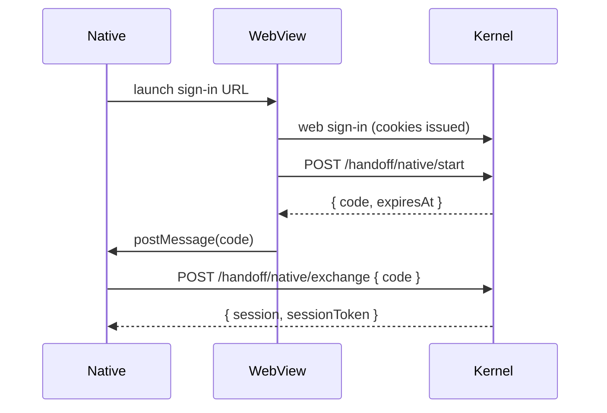

# Native handoff plugin

`authFnNativeHandoffPlugin` is the bridge between **a sign-in that happened in a web view (or a system browser)** and **a native app that needs a bearer credential**. Use it when:

- Your iOS / Android app wraps a web sign-in (Apple HIG-compliant `ASWebAuthenticationSession`, Custom Tabs).
- Your desktop electron / tauri app wraps a web sign-in.
- Your CLI opens a system browser to authenticate, then exchanges a code on a local socket.

```ts
import { authfn, authFnPlugins } from 'authfn';
import { authFnNativeHandoffPlugin } from '@authfn/native-handoff';

const authApp = authfn({
  plugins: authFnPlugins(
    authFnNativeHandoffPlugin({
      codeTtlSeconds: 300,   // 5 minutes
    }),
  ),
});
```

## Configuration

| Option | Default | Notes |
| --- | --- | --- |
| `codeTtlSeconds` | `60` | Lifetime of a handoff code before it expires; the example explicitly overrides this to 300 seconds. |
| `now` | `() => new Date()` | Clock injection. |

## Routes

| Method | Path | Operation ID | Notes |
| --- | --- | --- | --- |
| `POST` | `/auth/handoff/native/start` | `startNativeHandoff` | Issue a handoff code for the current session. |
| `POST` | `/auth/handoff/native/exchange` | `exchangeNativeHandoff` | Exchange the code for a session (bearer or cookie). |
| `POST` | `/auth/handoff/web/start` | `startWebHandoff` | Inverse: native → web. Issues a code the web side can exchange. |
| `GET` | `/auth/handoff/web/consume` | `consumeWebHandoff` | Web side hits this to consume the code. |

## Schema

| Table | Purpose |
| --- | --- |
| `authfn_handoff_codes` | `{ id, codeHash, sourceSessionId, target, regionId, userId, expiresAt, consumedAt, createdAt, metadata }`. |

Codes are hashed at rest; the plaintext is shown once at issuance.

## Native handoff (web → native) flow



The web view does the hard work (cookies, CSRF, OAuth state), then mints a one-time code. The native app exchanges that code for a bearer credential it stores in Keychain.

## Bridging through Apple's Web Authentication Session

`ASWebAuthenticationSession` returns control to your app on a callback URL. Configure your social-OAuth flow with `defaultHandoffMode: 'session-token'`, and the kernel will redirect to your callback URL with a handoff code embedded:

```
myapp://signed-in?code=<handoff-code>
```

Your iOS code parses the URL, calls `exchangeNativeHandoff`, and lands a bearer credential.

## Bridging through `WKScriptMessageHandler`

When you host a `WKWebView` inside your iOS app, install `AuthFnWebViewBridgeHost` to receive `postMessage` from the web side. The bridge exchanges native handoff codes, starts web handoffs and signs out for the pages you trust:

```swift
import AuthFnWebViewBridgeHost

let bridge = AuthFnWebViewBridgeHost(
    webView: webView,
    client: authFnClient,
    trustedOrigins: [URL(string: "https://app.example.com")!]
)
bridge.install(on: webView.configuration.userContentController)
```

Messages are accepted only from the main frame of a page whose origin (scheme, host and port) is exactly one of `trustedOrigins`. Any other page the web view loads, from a link, a redirect or an embed, is ignored, so it cannot make the app exchange an attacker's handoff code (signing the app in as the attacker), start a web handoff or sign out. Hosts are compared as WebKit reports them. For `http(s)`, `ws(s)` and `ftp` origins, percent escapes are decoded, IPv4 and IPv6 literals are put in canonical form (`http://127.1` matches `127.0.0.1`) and default ports are dropped, as WebKit does; an entry whose host WebKit would refuse (`https://example.test%3A8443`, `http://256.1.1.1`) is ignored. For custom schemes the host is kept as given. Give internationalized domains in their ASCII (punycode) form, IPv6 literals in brackets (`http://[::1]:5173`), and serve bundled pages from a `WKURLSchemeHandler` with a host (`app://portal`) rather than `file:` URLs. WebKit reports the same port (0) for a default port and an explicit `:0`, so when it reports 0 the page's own URL must show the same scheme and host; a page whose URL does not (such as an `about:blank` popup that inherited its origin) is refused. A page that inherited a trusted origin with a non-default port (`https://portal.example:8443`) has that same origin and is accepted, like any page of that origin. Entries with userinfo (`user@`) or a backslash in the authority are refused, because Foundation and WebKit can read their host differently. Entries that are not usable origins are ignored with a warning that names only their position in the list, never the URL. The initializer without `trustedOrigins` has been removed (it is now a compile error).

## Web handoff (native → web)

Less common, but useful when a native app wants to deep-link into a web page that should be authenticated as the native user. Native side calls `startWebHandoff`; the URL it hands to the web side carries `?code=<handoff-code>`. The web page calls `consumeWebHandoff`, sets cookies, and continues.

The consume URL must be loaded directly by the native app (the browser marks that `Sec-Fetch-Site: none`). A navigation that another site started (`cross-site` or `same-site`) is refused with `AUTHFN_VALIDATION_ERROR` and the code stays unused, so a page cannot sign its visitors into the page owner's account. A link opened from outside the browser (mail, chat, a QR code) is also `none`, so bind the code to the app: send `verifierChallenge` (base64url SHA-256 of a verifier the app keeps) to `/handoff/web/start`, and load the consume URL with the verifier in the `x-authfn-handoff-verifier` header. A code minted with a challenge is refused without the matching verifier. Because the caller of `/handoff/web/start` decides whether to send a challenge, set `requireWebHandoffVerifier: true` so unbound codes cannot be created or consumed at all. Set `webHandoff: false` to leave both web handoff routes unregistered when no app needs them. `returnTo` is reduced to a same-origin path; backslashes and control characters fall back to `/`.

## Errors

| Code | When |
| --- | --- |
| `AUTHFN_VALIDATION_ERROR` | Missing fields. |
| `AUTHFN_NOT_FOUND` | Code is unknown. |
| `AUTHFN_OTP_EXPIRED` | Code is past `expiresAt`. (We reuse the OTP-expired code class because semantically the same.) |
| `AUTHFN_OTP_REPLAYED` | Code already consumed. |
| `AUTHFN_REGION_MISMATCH` | The code's region doesn't match this authority. |

## Events

- `authfn.handoff.started`
- `authfn.handoff.exchanged`
- `authfn.handoff.failed`

## Multi-region

Handoff codes carry their `regionId`. If a code created on `us-east-1` is exchanged on `eu-west-1`, the kernel returns `AUTHFN_REGION_MISMATCH` with a `redirectTo` to the right authority. This means a native app holding a code can survive being routed to the wrong region by a load balancer — it'll just retry against the right one.

## Security

- Codes are single-use, short-lived, and bound to the issuing session.
- Codes hashed at rest with the same algorithm used for session tokens.
- Codes don't carry the user's identity in the plaintext — only the consumer of `exchangeNativeHandoff` sees the resolved session.
- Replay returns `AUTHFN_OTP_REPLAYED`.

## Related

- [SDKs → Swift](../sdk/swift) — `AuthFnSwift` exposes `exchangeNativeHandoff` and `startNativeHandoff`.
- [Plugins → Social OAuth](./social-oauth) — `defaultHandoffMode: 'session-token'`.
- [Recipes → Native mobile handoff](../recipes/native-mobile-handoff) — end-to-end walkthrough.
