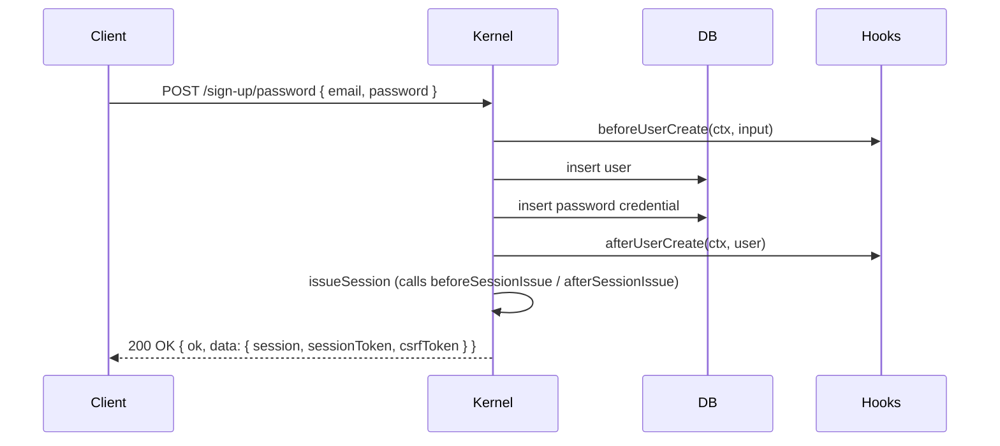
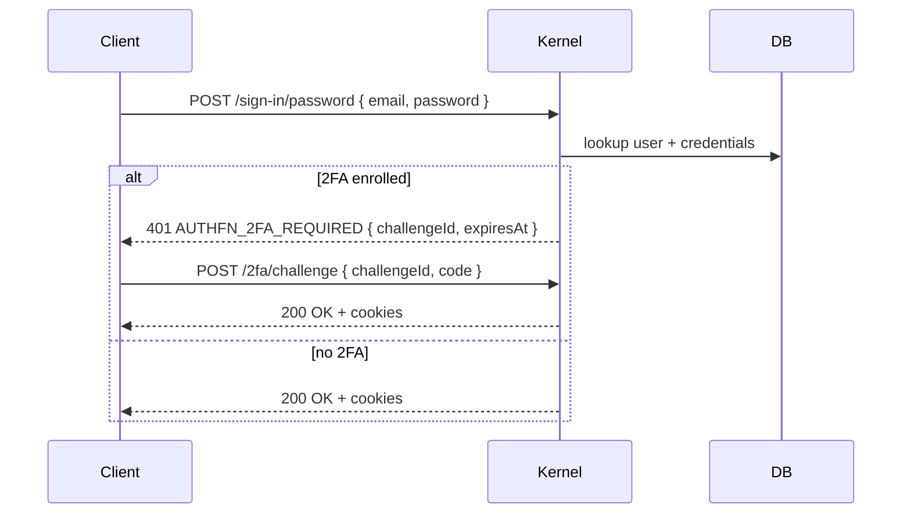
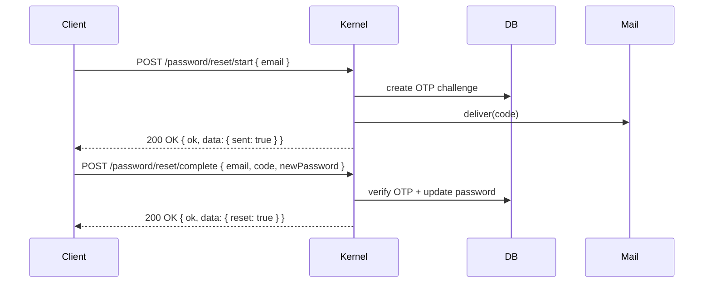

# Password plugin

The password plugin turns an `AuthFn` instance into something a user can sign up to with `{ email, password }`. It also wires the password-reset flow through the email-OTP plugin.

```ts
import { authfn, authFnPlugins } from 'authfn';
import { authFnPasswordPlugin } from '@authfn/password';

const authApp = authfn({
  plugins: authFnPlugins(authFnPasswordPlugin()),
});
```

## Configuration

Policy options go on the plugin factory. Password-reset OTP delivery belongs in `createServer({ pluginRuntime })`.

```ts
authFnPasswordPlugin({
  compromisedPasswordChecker: hibpChecker,
  requireEmailVerifiedForSignIn: false,
});

authApp.createServer({
  database,
  pluginRuntime: {
    password: {
      otp: {
        delivery: yourDelivery,
        challengeTtlSeconds: 600,
        maxAttempts: 5,
      },
    },
  },
});
```

| Option | Stage | Default | Notes |
| --- | --- | --- | --- |
| `compromisedPasswordChecker` | factory | `undefined` | A function that checks the password against breach data (e.g. HIBP). Called on sign-up and reset. Throws `AuthFnValidationError` if compromised. |
| `requireEmailVerifiedForSignIn` | factory | `false` | If `true`, sign-in returns `AUTHFN_EMAIL_NOT_VERIFIED` only after the password matches. A wrong password or a missing account returns `AUTHFN_INVALID_CREDENTIALS` with no account id. |
| `pluginRuntime.password.otp.delivery` | runtime | required for reset | Per-flow OTP delivery for password resets. |
| `pluginRuntime.password.otp.challengeTtlSeconds` | runtime | `600` (10 min) | TTL for password-reset OTPs. |
| `pluginRuntime.password.otp.maxAttempts` | runtime | `5` | Maximum verification attempts per challenge. |
| `pluginRuntime.password.otp.maxFailedAttemptsPerEmail`, `maxChallengesPerEmail`, `emailAttemptWindowSeconds` | runtime | `10`, `20`, `3600` | Per-email limits for reset codes, with the same meaning as in [Email OTP](./email-otp). The count covers every challenge for the email, so reset codes and sign-in codes add up, and the strictest value set for either plugin applies. |

## Routes

| Method | Path | Operation ID | Notes |
| --- | --- | --- | --- |
| `POST` | `/auth/sign-up/password` | `signUpWithPassword` | Create a user and issue a session. Body: `{ email, password, profile?, sessionMode? }`. `profile` must be a JSON object of at most 4 KB; it becomes the user's `metadata` (see [Sign-up profile](#sign-up-profile)). |
| `POST` | `/auth/sign-in/password` | `signInWithPassword` | Sign in. May respond with `AUTHFN_2FA_REQUIRED` if 2FA is enrolled. An unknown account, an account with no password set, and a wrong password all return the same `AUTHFN_INVALID_CREDENTIALS` error. |
| `POST` | `/auth/password/reset/start` | `startPasswordReset` | Send a password-reset OTP. Always returns `200 OK` regardless of email existence (anti-enumeration). |
| `POST` | `/auth/password/reset/complete` | `completePasswordReset` | Verify the OTP, set a new password and revoke every existing session of the user. |

All routes return the standard envelope. See [API reference](../api) for full schemas.

Password endpoints accept request bodies up to 64 KiB. A larger body, including one streamed without `Content-Length`, is rejected with HTTP 413 before the route runs. If the body takes longer than five seconds to arrive, the response is HTTP 408. Both errors use `AUTHFN_VALIDATION_ERROR`. A password longer than 1024 UTF-8 bytes is rejected with HTTP 400 before any password hashing.

Users with an existing password over 1024 UTF-8 bytes must reset it. Deployments without password-reset delivery need to arrange an operator-assisted reset for those accounts.

## Schema

| Table | Purpose |
| --- | --- |
| `authfn_password_credentials` | Stores `{ id, userId, passwordHash, createdAt, updatedAt }`. One row per user; password hashes only — never the plaintext. |

## Hashing

The TypeScript kernel uses **scrypt** with N=16384, r=8, p=1, a 16-byte salt and a 64-byte digest. New passwords must be at least 12 characters and at most 1024 UTF-8 bytes. Sign-in applies the byte limit and verifies the stored hash at that fixed cost. On Node.js, the derivation runs off the event loop. Each runtime allows up to four active operations and sixteen waiting operations. A full queue returns a retryable `AUTHFN_RATE_LIMITED` response.

## Sign-up flow



## Sign-in flow



## Password reset flow



A completed reset revokes all of the user's sessions (cookie and bearer) and any unfinished two-factor sign-in, including those started by someone who knew the old password. API keys are not revoked (on a verified account). On an account whose email was not verified yet, the reset also claims the account: see [Unverified accounts](#unverified-accounts).

## Account-linking interactions

When a user is already authenticated and `accountLinking.passwordForAuthenticatedUser` is `true`, calling `POST /auth/sign-up/password` with the user's own email **adds** a password credential to the existing account instead of creating a new user. A session cookie counts as authentication here only together with a valid `x-authfn-csrf` header (`@authfn/client` sends it); without it the request is treated as unauthenticated and returns `AUTHFN_CONFLICT`. A bearer session token works as before. See [Concepts → Account linking](../core-concepts/account-linking).

## Unverified accounts

Password sign-up does not verify the email, so anyone can sign up with an address they don't own, and with the session it returns add more ways in. The first proof of the mailbox claims the account for whoever made it. That proof is any of:

- signing in (or up, with `otpSignUpExistingUser`) with an email code;
- a `verify-email` code entered by anyone other than a signed-in holder of the account (a session cookie with its CSRF token, or a bearer session token). A request that carries a live session cookie of the same account without a valid CSRF token is refused with `AUTHFN_CSRF_INVALID` and the code stays unused, so a browser whose CSRF cookie expired before its session cannot wipe its own account. While the account is disabled (`metadata.disabled`), email codes for `sign-in`, linked `sign-up`, `verify-email`, and `reset-password` on an unverified account are refused with `AUTHFN_SESSION_REVOKED` and the code stays unused, so nothing is claimed or wiped;
- a completed password reset.

AuthFn then removes everything set up on the account before: the password (a reset keeps the new one), API keys, the second factor with its recovery codes and pending challenges, linked social accounts, native handoff codes and grants to OAuth clients (`@authfn/oauth-provider`). It revokes every session and marks the email verified before issuing the new session. Only installed plugins' data is touched: if a plugin is removed from the server and later added back against the same database, credentials it stored before a claim (API keys, linked accounts, second factors, OAuth client grants and remembered consents) become usable again. Before re-enabling a plugin, revoke what it holds for accounts claimed while it was off (for example, every OAuth grant and consent of a user whose email was verified after the plugin was removed). An account whose email is already verified is not affected.

## Sign-up profile

The `profile` sent to `/sign-up/password` (and to `/otp/verify` with purpose `sign-up`) becomes the new user's `metadata` unless a `beforeUserCreate` hook replaces it. It is data the caller chose: it must be a JSON object of at most 4 KB, and the `disabled` key, which AuthFn itself reads, is dropped. Don't read roles, plans, tenants or other authorization state from user metadata that came from a sign-up profile; set those from a `beforeUserCreate` hook or your own server code.

## Errors

| Code | When |
| --- | --- |
| `AUTHFN_VALIDATION_ERROR` | Missing email/password, password fails policy, or `compromisedPasswordChecker` returned `compromised: true`. |
| `AUTHFN_CONFLICT` | Email already in use (and account linking didn't apply). |
| `AUTHFN_INVALID_CREDENTIALS` | Sign-in: unknown account, account with no password set, or wrong password. |
| `AUTHFN_EMAIL_NOT_VERIFIED` | Sign-in blocked because `requireEmailVerifiedForSignIn` is on and the password matched. |
| `AUTHFN_2FA_REQUIRED` | Sign-in succeeded for primary; 2FA challenge needs to complete. |
| `AUTHFN_REGION_MISMATCH` | Multi-region: this email lives in another region. |
| `AUTHFN_OTP_INVALID` / `AUTHFN_OTP_EXPIRED` / `AUTHFN_OTP_REPLAYED` | Password reset OTP failures. |

## Events

- `authfn.user.created` — sign-up succeeded.
- `authfn.session.issued` — session issued (sign-up or sign-in).
- `authfn.account_linked` — sign-up linked into an existing account.
- `authfn.password.signup.rollback_failed` — sign-up failed mid-write and rollback was incomplete.
- `authfn.session.revoked` — covered by sign-out paths, not by this plugin specifically.

## Compromised password check

`compromisedPasswordChecker` lets you wire HIBP, your own breach corpus, or a deny-list:

```ts
import type { AuthFnPasswordCompromiseChecker } from 'authfn';

const hibpChecker: AuthFnPasswordCompromiseChecker = async ({ password }) => {
  const sha1 = await sha1Hex(password);
  const prefix = sha1.slice(0, 5).toUpperCase();
  const suffix = sha1.slice(5).toUpperCase();
  const text = await fetch(`https://api.pwnedpasswords.com/range/${prefix}`).then((r) => r.text());
  for (const line of text.split('\n')) {
    const [s, count] = line.trim().split(':');
    if (s === suffix) return { compromised: true, count: Number(count) };
  }
  return false;
};

authFnPasswordPlugin({ compromisedPasswordChecker: hibpChecker });
```

If the checker returns `{ compromised: true }`, the kernel throws `AuthFnValidationError('password is compromised', { ... })`. Display a "this password has appeared in a data breach" hint in your UI.

## Example client usage

```ts
const session = await client.signUpWithPassword({
  email: 'ada@example.com',
  password: 'correct horse battery staple',
});

const sameSession = await client.signInWithPassword({
  email: 'ada@example.com',
  password: 'correct horse battery staple',
});

await client.startPasswordReset({ email: 'ada@example.com' });
await client.completePasswordReset({
  email: 'ada@example.com',
  code: '123456',
  newPassword: 'a different one',
});
```

## Related

- [Core concepts → Account linking](../core-concepts/account-linking)
- [Plugins → Email OTP](./email-otp)
- [Plugins → Two-factor](./two-factor)
- [Recipes → Password reset](../recipes/password-reset)
- [Examples → password-sessions](../examples/password-sessions)
