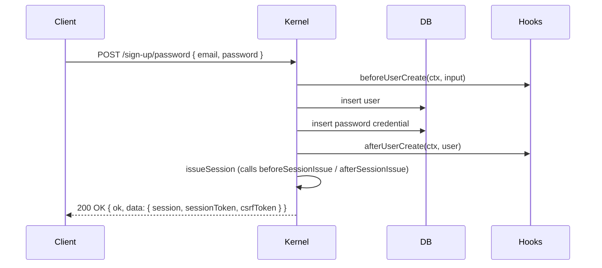
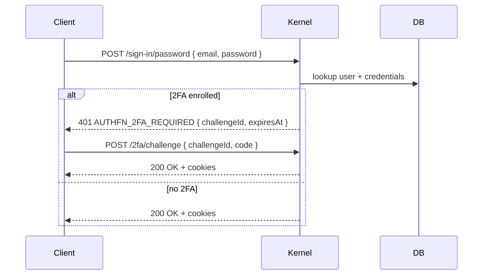
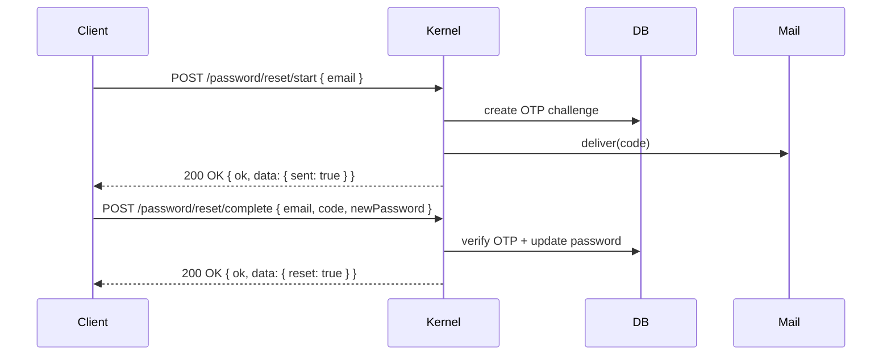

# Password plugin

The password plugin turns an `AuthFn` instance into something a user can sign up to with `{ email, password }`. It also wires the password-reset flow through the email-OTP plugin.

```ts
import { authfn, authFnPlugins } from 'authfn';
import { authFnPasswordPlugin } from '@authfn/password';

const authApp = authfn({
  plugins: authFnPlugins(authFnPasswordPlugin()),
});
```

## Configuration

Policy options go on the plugin factory. Password-reset OTP delivery belongs in `createServer({ pluginRuntime })`.

```ts
authFnPasswordPlugin({
  compromisedPasswordChecker: hibpChecker,
  requireEmailVerifiedForSignIn: false,
});

authApp.createServer({
  database,
  pluginRuntime: {
    password: {
      otp: {
        delivery: yourDelivery,
        challengeTtlSeconds: 600,
        maxAttempts: 5,
      },
    },
  },
});
```

| Option | Stage | Default | Notes |
| --- | --- | --- | --- |
| `compromisedPasswordChecker` | factory | `undefined` | A function that checks the password against breach data (e.g. HIBP). Called on sign-up and reset. Throws `AuthFnValidationError` if compromised. |
| `requireEmailVerifiedForSignIn` | factory | `false` | If `true`, sign-in fails with `AUTHFN_EMAIL_NOT_VERIFIED` until the user verifies their email. |
| `passwordHashCost` | factory | `'current'` | The scrypt cost new hashes are written at. `'legacy'` writes the pre-AUTH-32 cost and stops sign-in from upgrading older hashes; use it only during a rolling deploy (see [Hashing](#hashing)). |
| `pluginRuntime.password.otp.delivery` | runtime | required for reset | Per-flow OTP delivery for password resets. |
| `pluginRuntime.password.otp.challengeTtlSeconds` | runtime | `600` (10 min) | TTL for password-reset OTPs. |
| `pluginRuntime.password.otp.maxAttempts` | runtime | `5` | Maximum verification attempts per challenge. |

## Routes

| Method | Path | Operation ID | Notes |
| --- | --- | --- | --- |
| `POST` | `/auth/sign-up/password` | `signUpWithPassword` | Create a user and issue a session. Body: `{ email, password, profile?, sessionMode? }`. |
| `POST` | `/auth/sign-in/password` | `signInWithPassword` | Sign in. May respond with `AUTHFN_2FA_REQUIRED` if 2FA is enrolled. |
| `POST` | `/auth/password/reset/start` | `startPasswordReset` | Send a password-reset OTP. Always returns `200 OK` regardless of email existence (anti-enumeration). |
| `POST` | `/auth/password/reset/complete` | `completePasswordReset` | Verify the OTP and set a new password. |

All routes return the standard envelope. See [API reference](../api) for full schemas.

## Schema

| Table | Purpose |
| --- | --- |
| `authfn_password_credentials` | Stores `{ id, userId, passwordHash, createdAt, updatedAt }`. One row per user; password hashes only — never the plaintext. |

## Hashing

Passwords are hashed with **scrypt** at N = 2^15, r = 8, p = 3 (32 MiB per hash), one of the settings OWASP recommends, and stored as `scrypt$N$r$p$salt$hash`. The hash runs asynchronously, so it does not block the event loop.

- **Upgrades:** a hash stored with the parameters used before AUTH-32 (N = 2^14, r = 8, p = 1) still verifies, and is re-hashed with the current ones the next time its password is used to sign in. The re-hash only replaces the hash it read.
- **A credential that changes during sign-in:** after the check, the stored credential is read again (a few times at most). If it changed (a reset, or another sign-in's upgrade), the submitted password must match the new hash, so a password reset during a sign-in with the old password refuses that sign-in. `AUTHFN_EMAIL_NOT_VERIFIED` is only given after this.
- **Rolling deploys:** releases before this one cannot read the new hashes (their scrypt memory limit is too low). While servers on an earlier release share the database, deploy with `passwordHashCost: 'legacy'`: new hashes are then written at the older cost and sign-in does not upgrade any. Once every server runs this release, remove the option (or set `'current'`). Do not roll back to an earlier release once current-cost hashes exist.
- **Length:** new passwords (sign-up, change, reset) are 12 to 1024 characters. Existing passwords up to 64 KiB (UTF-8) still sign in; a longer submitted password is refused with `AUTHFN_INVALID_CREDENTIALS` before any lookup or hashing. The request body itself is not limited here: set a body size limit in front of AuthFn.
- **Reset order:** a reset counts its code attempt first. Only a matching code goes on to the new password's length and policy checks and its hash, before the code is used; a refused password hands the attempt back, so the user can retry with the same code. A wrong code, or a code with no attempts left, gets the same answer whatever the new password.
- **Bounded hashing:** each process runs at most 16 scrypt jobs at once and queues up to 1024 more; beyond that, sign-in returns `AUTHFN_RATE_LIMITED`. A sign-in's two jobs are admitted together, or the request is refused before either is queued. Sign-in hashes even for unknown emails, so enable the HTTP rate limiter as well.
- **Stored parameters:** only the two parameter sets AuthFn has written are evaluated, with a full 64-byte digest; anything else is treated as corrupt, which bounds the work a stored hash can ask for.
- **Same answer for every email:** every sign-in does the same work, one scrypt at the current cost and one at the older cost, queued in that order, whether or not the email has an account or a password and whichever cost its hash is stored at (for an older hash, the current-cost one becomes its upgrade when the password is right). No hash is derived at start-up. With `requireEmailVerifiedForSignIn`, `AUTHFN_EMAIL_NOT_VERIFIED` is only given after the password has been checked, and does not name the user.
- **Workers:** in workerd, scrypt runs synchronously, so each sign-in spends roughly 120–150 ms of CPU on hashing, unknown emails included. A Worker whose CPU limit is lower ends those requests instead of answering 401. Check that your Workers plan's CPU limit allows it, or run password routes where it does.

## Sign-up flow



## Sign-in flow



## Password reset flow



## Account-linking interactions

When a user is already authenticated and `accountLinking.passwordForAuthenticatedUser` is `true`, calling `POST /auth/sign-up/password` with the user's own email **adds** a password credential to the existing account instead of creating a new user. See [Concepts → Account linking](../core-concepts/account-linking).

## Errors

| Code | When |
| --- | --- |
| `AUTHFN_VALIDATION_ERROR` | Missing email/password, password fails policy, or `compromisedPasswordChecker` returned `compromised: true`. |
| `AUTHFN_CONFLICT` | Email already in use (and account linking didn't apply). |
| `AUTHFN_INVALID_CREDENTIALS` | Sign-in: wrong email or password. |
| `AUTHFN_EMAIL_NOT_VERIFIED` | Sign-in blocked because `requireEmailVerifiedForSignIn` is on. |
| `AUTHFN_2FA_REQUIRED` | Sign-in succeeded for primary; 2FA challenge needs to complete. |
| `AUTHFN_REGION_MISMATCH` | Multi-region: this email lives in another region. |
| `AUTHFN_OTP_INVALID` / `AUTHFN_OTP_EXPIRED` / `AUTHFN_OTP_REPLAYED` | Password reset OTP failures. |

## Events

- `authfn.user.created` — sign-up succeeded.
- `authfn.session.issued` — session issued (sign-up or sign-in).
- `authfn.account_linked` — sign-up linked into an existing account.
- `authfn.password.signup.rollback_failed` — sign-up failed mid-write and rollback was incomplete.
- `authfn.session.revoked` — covered by sign-out paths, not by this plugin specifically.

## Compromised password check

`compromisedPasswordChecker` lets you wire HIBP, your own breach corpus, or a deny-list:

```ts
import type { AuthFnPasswordCompromiseChecker } from 'authfn';

const hibpChecker: AuthFnPasswordCompromiseChecker = async ({ password }) => {
  const sha1 = await sha1Hex(password);
  const prefix = sha1.slice(0, 5).toUpperCase();
  const suffix = sha1.slice(5).toUpperCase();
  const text = await fetch(`https://api.pwnedpasswords.com/range/${prefix}`).then((r) => r.text());
  for (const line of text.split('\n')) {
    const [s, count] = line.trim().split(':');
    if (s === suffix) return { compromised: true, count: Number(count) };
  }
  return false;
};

authFnPasswordPlugin({ compromisedPasswordChecker: hibpChecker });
```

If the checker returns `{ compromised: true }`, the kernel throws `AuthFnValidationError('password is compromised', { ... })`. Display a "this password has appeared in a data breach" hint in your UI.

## Example client usage

```ts
const session = await client.signUpWithPassword({
  email: 'ada@example.com',
  password: 'correct horse battery staple',
});

const sameSession = await client.signInWithPassword({
  email: 'ada@example.com',
  password: 'correct horse battery staple',
});

await client.startPasswordReset({ email: 'ada@example.com' });
await client.completePasswordReset({
  email: 'ada@example.com',
  code: '123456',
  newPassword: 'a different one',
});
```

## Related

- [Core concepts → Account linking](../core-concepts/account-linking)
- [Plugins → Email OTP](./email-otp)
- [Plugins → Two-factor](./two-factor)
- [Recipes → Password reset](../recipes/password-reset)
- [Examples → password-sessions](../examples/password-sessions)
