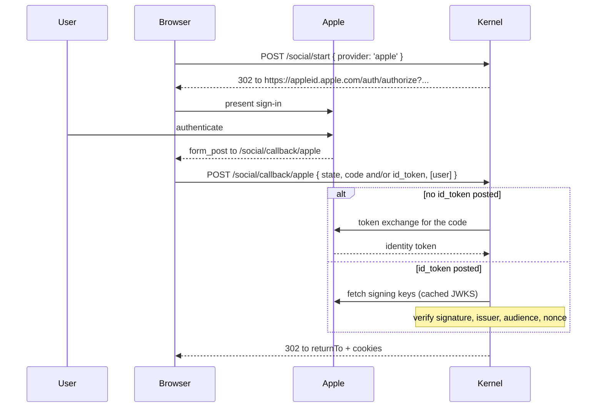
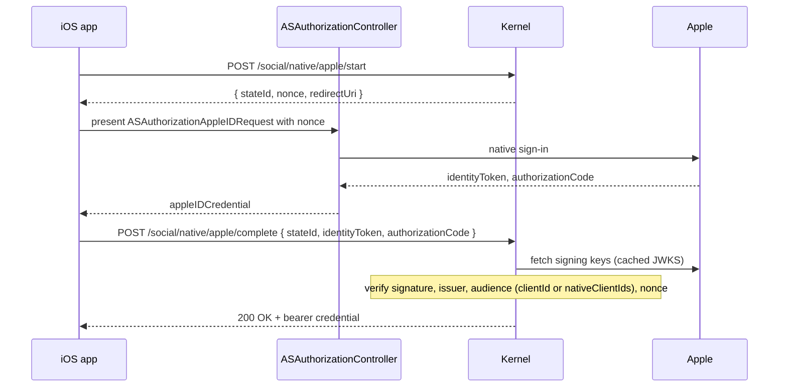

# Apple

Sign in with Apple has a few quirks compared to other OAuth providers:

- Apple's **client secret is itself a JWT**, signed with the private key Apple gave you. Most servers regenerate it periodically; authfn lets you supply a generator function so you don't bake an expiring JWT into config.
- Apple's callback uses **`response_mode=form_post`** — the response is `POST`ed to the redirect URI as a form, not appended as query parameters. authfn handles this transparently with the `POST /auth/social/callback/apple` route.
- Apple **only sends the user's name on the very first authorization**. authfn captures it on the initial sign-up and never expects it again.
- Apple supports a **native flow** on iOS and macOS via `ASAuthorizationAppleIDProvider`. authfn integrates with it through `/auth/social/native/apple/start` and `/auth/social/native/apple/complete`.

## Setup

1. Create an App ID + Service ID at [Apple Developer → Certificates, IDs & Profiles](https://developer.apple.com/account/resources/identifiers/list).
2. Create a Sign in with Apple key (download the `.p8`).
3. In your config, supply the **team id**, the **key id**, the **Service ID** (this is the OAuth `client_id` from authfn's perspective), and the **redirect URI** registered in the Apple console.

## Configuration

Start with the [full two-stage Social OAuth skeleton](./index); the fragment
below assumes that page's `authApp` declaration and `database` adapter.

```ts
import { createAppleClientSecret } from './apple-secret.js';   // your generator

authApp.createServer({
  database,
  pluginRuntime: {
    socialOAuth: {
      providers: {
        apple: {
          clientId: process.env.APPLE_SERVICE_ID!,                    // your Services Id
          clientSecretResolver: async () => createAppleClientSecret({
            teamId: process.env.APPLE_TEAM_ID!,
            keyId: process.env.APPLE_KEY_ID!,
            privateKeyPem: process.env.APPLE_PRIVATE_KEY!,
            clientId: process.env.APPLE_SERVICE_ID!,
          }),
          allowlistedRedirectUris: ['https://app.example.com/auth/social/callback/apple'],
          nativeClientIds: ['com.example.app'],                       // bundle ids for native flow
        },
      },
    },
  },
});
```

`clientSecretResolver` is preferred over a static `clientSecret` because Apple secrets expire (≤ 6 months). The resolver is called per-request; cache the JWT for ≤ 1 hour and reuse.

## Web flow



With the default `response_type=code`, Apple posts a `code` and the kernel exchanges it at Apple's token endpoint for the identity token. If the post carries an `id_token` (with or without a `code`), the kernel uses that token and does not exchange any code, and verifies it against `https://appleid.apple.com/auth/keys` (cached JWKS). Either way the token's `sub` becomes `providerAccountId`. See [Email and verification](#email-and-verification) for where the email comes from.

## Native iOS / macOS flow

Native Sign in with Apple on iOS and macOS gives the user a system sheet — no Safari, no fragment. The flow is:



The kernel verifies the `identityToken` itself; it does not exchange the `authorizationCode`.

`nativeClientIds` should include the bundle ids that your app may sign in from. Multiple bundle ids are supported (development vs production).

The `AuthFnSwift` SDK encapsulates this flow — see [SDKs → Swift](../sdk/swift).

## First-time-only name

Apple sends the user's name on the very first authorization only — subsequent flows return only the `sub` and email. The kernel persists the name on `authfn_users.metadata` if you provide one in the initial request body (`profile.name`). The native iOS API will give you a `fullName` you should pass through.

## Email and verification

authfn takes the email, and whether it is verified, only from Apple's identity token, never from the `user` value. That value, which Apple posts on the first authorization (and the `user` object the native complete route accepts), is not signed, so authfn never takes an email from it: the web `form_post` identity-token path and the native route read only the name from it, and the code-exchange path ignores it entirely. Where the token comes from decides how it is checked:

- **Code exchange** (`/social/callback/apple` with a `code`): the token is the one Apple's token endpoint returns to the server over TLS for that code.
- **Web `form_post` identity token** (`/social/callback/apple` with an `id_token`) and the **native route** (`/social/native/apple/complete`): the token arrives through the client, so authfn checks its signature against Apple's keys, its issuer and audience, and that its nonce matches the sign-in it started.

The email counts as verified only when the token's `email_verified` claim is `true`; a missing claim counts as unverified. A new account gets `emailVerifiedAt` only for a verified email. Whether an unverified email may link to an existing account is set by `accountLinking.oauthByVerifiedEmail.requireProviderEmailVerified` (default `true`, which refuses the link).

When the token has no `email` claim:

- the web callback rejects the sign-in;
- the native route resolves the sign-in by the Apple subject alone. An Apple ID already linked to an account signs in as before and keeps the email and profile stored for it; a new one creates an account with no email. It never links by email.

## Email relay

Apple optionally relays mail through a per-app email alias (e.g. `xxxxx@privaterelay.appleid.com`). authfn treats relay emails like any other email — they just won't match a "real" inbox. Display names should not assume a particular email format.

## Signature checks in every environment

An identity token that reaches the kernel through the client (a web `form_post` `id_token`, or the native complete route) is always checked against Apple's keys, whatever the environment: there is no setting that accepts unsigned (`alg: none`) tokens. Tests sign their tokens with a local key and serve its public key in place of Apple's key set. A token the kernel gets itself from Apple's token endpoint, in exchange for a `code`, arrives over TLS from Apple and is read without a signature check.

## Errors specific to Apple

- `invalid_client` from Apple typically means an expired or wrong client-secret JWT. Verify your `clientSecretResolver` is producing fresh JWTs.
- Identity token verification failures bubble up as `AUTHFN_OAUTH_CALLBACK_INVALID` with `details.reason = 'identity_token_invalid'`.
- Native start without a registered `nativeClientIds` returns `AUTHFN_OAUTH_PROVIDER_UNSUPPORTED`.
