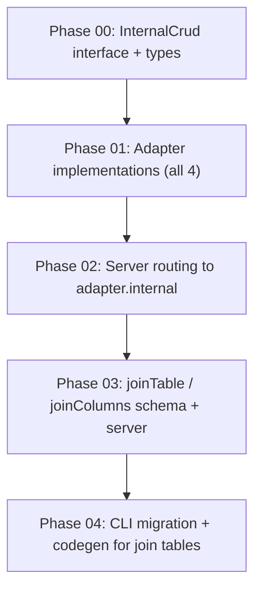

# Plan

## Architecture

```
┌─────────────────────────────────────────────────────────┐
│  @superfunctions/db  (packages/db)                      │
│                                                         │
│  ┌─────────────────┐   ┌──────────────────────────────┐ │
│  │  Adapter         │   │  InternalCrud (NEW)          │ │
│  │  .create()       │   │  .ensureTable()              │ │
│  │  .findOne()      │   │  .create() / .findOne()      │ │
│  │  .findMany()     │   │  .findMany() / .update()     │ │
│  │  .update()       │   │  .delete()                   │ │
│  │  .delete()       │   │                              │ │
│  │  .internal ──────┼───┤  Bypasses ORM schema         │ │
│  └─────────────────┘   │  resolution entirely          │ │
│                         └──────────────────────────────┘ │
│                                                         │
│  Adapters:  drizzle │ prisma │ kysely │ memory           │
└─────────────────────────────────────────────────────────┘
         ▲                    ▲
         │ user tables        │ internal tables
         │ (normal CRUD)      │ (raw CRUD)
┌────────┴────────────────────┴───────────────────────────┐
│  @datafn/server  (datafn/server)                        │
│                                                         │
│  sequence-store.ts  ──► adapter.internal.__datafn_meta   │
│  change-tracking.ts ──► adapter.internal.__datafn_*      │
│  idempotency-db.ts  ──► adapter.internal.__datafn_idemp  │
│  seed.ts            ──► adapter.internal.__datafn_seed   │
│  relations.ts       ──► adapter.create (joinTable)       │
│                     OR  adapter.internal (fallback)      │
│  db-store.ts        ──► adapter (joinTable or internal)  │
└─────────────────────────────────────────────────────────┘
         ▲
         │ schema with joinTable/joinColumns
┌────────┴────────────────────────────────────────────────┐
│  @datafn/core  (datafn/core)                            │
│  DatafnRelationSchema + joinTable + joinColumns          │
└─────────────────────────────────────────────────────────┘
         ▲
         │ migration generation
┌────────┴────────────────────────────────────────────────┐
│  @datafn/cli  (datafn/cli)                              │
│  generate-migration: named join tables in DDL           │
│  codegen: join table interfaces                          │
└─────────────────────────────────────────────────────────┘
```

## Dependency Graph



## Phases Overview

| Phase | Goal                                                    | Delivered Capability                         | Verification                                       |
| ----- | ------------------------------------------------------- | -------------------------------------------- | -------------------------------------------------- |
| 00    | Define `InternalCrud` interface and types               | Exported types compile                       | `tsc --noEmit`                                     |
| 01    | Implement `InternalCrud` in all 4 adapters              | Internal CRUD works in tests                 | `vitest` adapter tests                             |
| 02    | Route server internal tables through `adapter.internal` | Server works with Drizzle adapter            | `vitest` server tests + manual example server test |
| 03    | Add `joinTable`/`joinColumns` to schema, update server  | Named join tables resolve via normal adapter | `vitest` server relation tests                     |
| 04    | CLI generates named join table DDL + TS interfaces      | Migration + codegen output correct           | `vitest` CLI tests                                 |

## Definition of Done

No phase is complete unless its verification steps pass. All existing tests in `@superfunctions/db`, `@datafn/server`, `@datafn/core`, and `@datafn/cli` MUST continue to pass after each phase.
