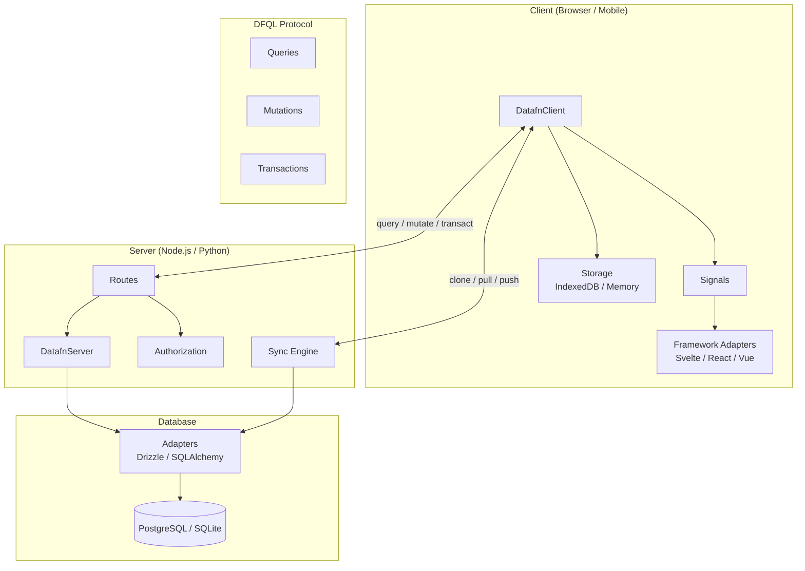

# PHASE_08: Cross-Link DFQL Pages from Main Documentation + System Architecture Diagram

## Phase Goal

Add contextual cross-links from main documentation pages (client queries, mutations, transactions, signals) to the corresponding DFQL reference pages. Create a mermaid system architecture diagram and add it to the home page and concepts overview page.

## In Scope

- LNK-001: Cross-links from client/queries.mdx to DFQL pages
- LNK-002: Cross-links from client/mutations.mdx to DFQL mutations
- LNK-003: Cross-links from client/transactions.mdx to DFQL transactions
- LNK-004: Cross-links from client/signals.mdx to DFQL pages
- DIA-001: Create mermaid system architecture diagram
- DIA-002: Add diagram to docs home page
- DIA-003: Add diagram to concepts overview page

## Out of Scope

- Python SDK merge (Phase 9)
- Modifying DFQL page content

## Deliverables

| File | Action |
|---|---|
| `datafn/docs/content/docs/documentation/client/queries.mdx` | UPDATE — add DFQL cross-links |
| `datafn/docs/content/docs/documentation/client/mutations.mdx` | UPDATE — add DFQL cross-link |
| `datafn/docs/content/docs/documentation/client/transactions.mdx` | UPDATE — add DFQL cross-link |
| `datafn/docs/content/docs/documentation/client/signals.mdx` | UPDATE — add DFQL cross-links |
| `datafn/docs/content/docs/index.mdx` | UPDATE — add system architecture diagram |
| `datafn/docs/content/docs/documentation/concepts/overview.mdx` | UPDATE — add system architecture diagram (replacing placeholder from Phase 7) |

## Requirements Covered

LNK-001, LNK-002, LNK-003, LNK-004, DIA-001, DIA-002, DIA-003

## Implementation Tasks

### DIA-001: Create system architecture diagram

1. [ ] Design a mermaid diagram showing the DataFn system architecture:



2. [ ] Verify the diagram renders correctly in MDX by checking mermaid support in the docs framework

### DIA-002: Add diagram to home page

3. [ ] Update `datafn/docs/content/docs/index.mdx`:
   - Add a "## System Architecture" section after the intro text
   - Include the mermaid diagram
   - Add brief explanatory text: "DataFn connects your client application to your server through DFQL, a structured query language. The client operates offline-first with local storage, syncing changes when online."

### DIA-003: Add diagram to concepts overview

4. [ ] Update `documentation/concepts/overview.mdx` (created in Phase 7):
   - Replace the diagram placeholder with the actual mermaid diagram
   - Position it near the top of the page, after the "What is DataFn" intro

### LNK-001: Cross-link client/queries.mdx

5. [ ] Open `documentation/client/queries.mdx`
6. [ ] After the Filters section heading/example, add:
   > See the full [DFQL Filters reference](/docs/dfql/filters) for all filter operators and logical combinators.
7. [ ] After the Sorting section, add:
   > See the full [DFQL Sorting reference](/docs/dfql/sorting) for all sorting options.
8. [ ] After the Pagination section, add:
   > See the full [DFQL Pagination reference](/docs/dfql/pagination) for cursor-based and offset-based strategies.
9. [ ] If there's a Select/projection section, add:
   > See the full [DFQL Select reference](/docs/dfql/select) for field projection and computed fields.
10. [ ] If there's an Aggregations section, add:
    > See the full [DFQL Aggregations reference](/docs/dfql/aggregations) for all aggregation functions.
11. [ ] If there's a Search section, add:
    > See the full [DFQL Search reference](/docs/dfql/search) for full-text search options.

### LNK-002: Cross-link client/mutations.mdx

12. [ ] Open `documentation/client/mutations.mdx`
13. [ ] Add near the top or after the first mutation example:
    > For the complete DFQL mutation specification including batch operations and guards, see the [DFQL Mutations reference](/docs/dfql/mutations).

### LNK-003: Cross-link client/transactions.mdx

14. [ ] Open `documentation/client/transactions.mdx`
15. [ ] Add near the top:
    > For the complete DFQL transaction specification, see the [DFQL Transactions reference](/docs/dfql/transactions).

### LNK-004: Cross-link client/signals.mdx

16. [ ] Open `documentation/client/signals.mdx`
17. [ ] Where signal query options (sort, filter, select) are discussed, add:
    > Signals accept all standard [DFQL query options](/docs/dfql/queries) including [filters](/docs/dfql/filters), [sorting](/docs/dfql/sorting), and [select projections](/docs/dfql/select).

## Verification Steps

1. Doc site builds:
   ```bash
   cd datafn/docs && npm run build
   ```
2. Manual review: all cross-links point to valid pages.
3. Mermaid diagram renders correctly on home page and overview page.
4. Links are contextual and non-intrusive (no "wall of links").

## Stop Condition

- All 4 client doc pages have contextual DFQL cross-links.
- Mermaid diagram renders on home page and concepts overview.
- Doc site builds successfully.
- All links resolve to valid pages.
