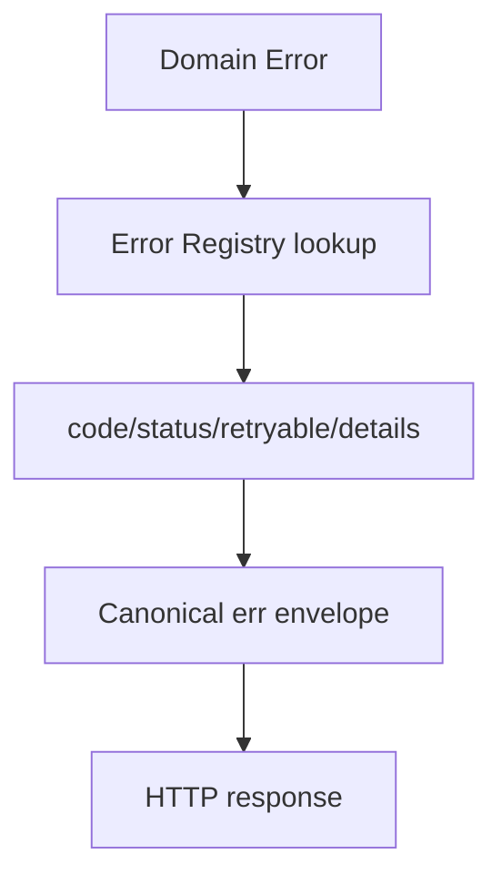

Canonical envelope stack:

- `@superfunctions/envelope`
- `@superfunctions/errors`

## Workflow

## Security Caveats

- Never expose internal stack traces in public envelope payloads.

## Operational Caveats

- Keep code->status mapping stable across services.
