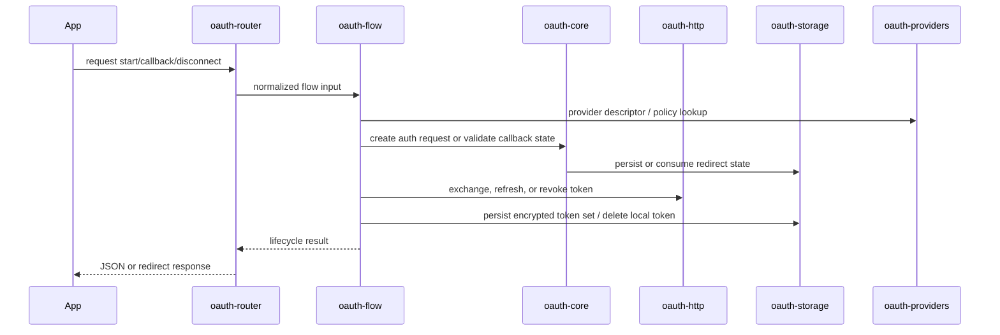

## Layering

The shared OAuth stack is intentionally split so apps can reuse the same lifecycle pieces without duplicating provider logic, storage rules, or route glue:

- `@superfunctions/oauth-core`: provider descriptors, PKCE, redirect validation, callback invariants
- `@superfunctions/oauth-http`: token exchange, refresh, revoke transport
- `@superfunctions/oauth-storage`: state stores, token vaults, encryption helpers
- `@superfunctions/oauth-providers`: curated descriptors and provider-policy registry
- `@superfunctions/oauth-flow`: start/callback/refresh/disconnect orchestration
- `@superfunctions/oauth-router`: reusable route factories on top of `oauth-flow`
- `@superfunctions/oauth-testing`: deterministic fixtures for tests

## Workflow



## Production Guidance

- Prefer `EncryptedTokenVault` so ciphertext, not plaintext token JSON, becomes the durable record format.
- `oauth-flow` defaults to `encrypted-required`; `plaintext-unsafe` should stay limited to tests and tightly controlled migration windows.
- `createDefaultProviderPolicyRegistry()` is an in-memory convenience path. Durable consent or audit retention requires explicit stores.
- `oauth-router` is the route-inventory layer. Framework adapters still belong in `@superfunctions/http-*` packages or the consuming app.

## Verification

Use the shared repo-root gate when you need a reproducible release check for the audited OAuth family:

```bash
npm run gate:packages-oauth-shared
```

That gate builds the dependency closure for the shared OAuth packages, runs each package-local test command from `repo root`, and fails if the shared OAuth README/docs inventory is incomplete.

## Migration Direction

Legacy function-local OAuth implementations should converge on the shared stack:

- move protocol invariants into `@superfunctions/oauth-core`
- move token transport into `@superfunctions/oauth-http`
- move persistence into `@superfunctions/oauth-storage`
- expose HTTP endpoints through `@superfunctions/oauth-router`
- keep app-specific identity and product behavior in `oauth-flow` hooks or the consuming app

This is the path intended for packages such as `plugfn` and for downstream apps that want one reusable OAuth substrate across integrations.
