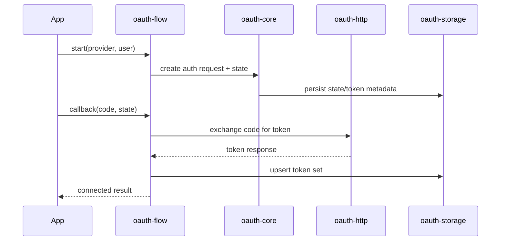

## Workflow



## Legacy Migration

Legacy path: `plugfn/auth/oauth-flow` and function-local orchestrations.

Current path: `@superfunctions/oauth-flow` + `@superfunctions/oauth-http` + `@superfunctions/oauth-storage`.

## External Consumer Example

```ts
import { createOAuthFlowService } from "@superfunctions/oauth-flow";
```

## Superfunction Consumer Example

```ts
import { createOAuthFlowService } from "@superfunctions/oauth-flow";
// used by authfn and plugfn wrappers internally
```

## Security Caveats

- Require strict state verification and PKCE for public clients.
- Never emit tokens in logs or metrics events.
- Reject dynamic redirect URIs outside allowlist.

## Operational Caveats

- Ensure deterministic provider/runtime config loading across environments.
- Emit request IDs and provider IDs for start/callback/refresh/disconnect events.
