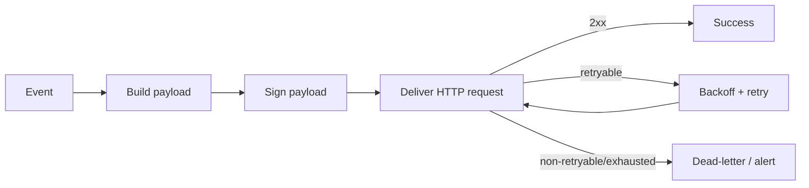

## Pipeline

## Security Caveats

- Use timing-safe signature verification.
- Rotate signing keys and support overlap windows.

## Operational Caveats

- Bound retries and backoff to prevent thundering herd.
- Capture delivery status and response metadata for debugging.
