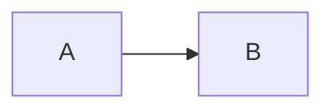

# SPEC: DocsFn Documentation Site

## Metadata

| Field | Value |
|---|---|
| Timestamp | 2026-03-22T14:00:00Z |
| Agent | unknown-agent |
| Model | Claude Opus 4.6 |
| Launcher | unknown |
| Workspace | /Users/serro/Documents/dev/n/superfunctions |
| OS / Shell | Darwin 25.3.0 / zsh |
| Git Branch | next |
| Git Dirty | yes |
| spec_folder | 2026-03-22-new-v7k2m9x4-spec |
| spec_type | new |
| spec_id | v7k2m9x4 |
| Input Paths | docsfn/core/src/, docsfn/sveltekit/src/, docsfn/svelte/src/, docsfn/provider-fs/src/, docsfn/cli/src/, docsfn/examples/sveltekit-docs-site/, datafn/docs/, searchfn/docs/, packages/docs-theme/ |

---

## Overview

Build a production documentation website for the **docsfn** project, located at `docsfn/docs/`. The site MUST use **SvelteKit 2 + @docsfn/sveltekit + @docsfn/svelte** — dogfooding docsfn's own framework rather than Fumadocs. The site serves as both the canonical reference for docsfn users and a living proof-of-concept that docsfn can power a real docs site end-to-end.

The site MUST include:
- A **Docs** section with comprehensive getting-started guides, core concepts (config, content, sidebars, navigation, search, SEO, theming, versioning, blog, analytics, security, OpenAPI, RSS, CLI), and deep customization guides.
- An **API Reference** section with per-package reference documentation for all 7 docsfn packages.
- A **Blog** section for release notes and announcements.
- **Full-text search** powered by searchfn.
- Visual consistency with existing superfunctions docs sites (datafn, searchfn, hostfn).

---

## Glossary

| Term | Definition |
|---|---|
| **docsfn** | The documentation toolchain within the superfunctions monorepo; comprises core, provider-fs, react, svelte, next, sveltekit, and cli packages. |
| **manifest** | The `DocsManifest` object produced by `buildManifest()` — contains all pages, posts, APIs, sidebars, and routes. |
| **search artifact** | The `DocsSearchArtifact` JSON blob produced by `buildSearchIndex()` — contains pre-indexed documents for client-side search via searchfn. |
| **surface** | `SvelteDocsPageSurface` — per-route metadata (breadcrumbs, pagination, headings, versions, topNav) resolved at load time. |
| **provider** | A `DocsContentProvider` implementation (e.g., `FsContentProvider`) that lists and loads content entries. |
| **sidebar definition** | A named sidebar declared in `navigation.sidebars` of the docsfn config; controls which pages appear in a given sidebar tree. |
| **meta.json** | Per-directory control file that defines page ordering, labels, icons, and grouping within the sidebar. |
| **compat preset** | A compatibility mode (`"none"` or `"fumadocs-v15"`) that transforms legacy content formats. This site uses `"none"`. |
| **content root** | The `content.root` directory from which the FsContentProvider reads all collections (docs, blog, api, pages, assets). |
| **topNav** | The top navigation bar items defined in `navigation.topNav` config. |
| **shared theme** | The visual identity (colors, typography, layout tokens) consistent across all superfunctions docs sites. Since `@superfunctions/docs-theme` is fumadocs/React-specific, the SvelteKit site MUST replicate the visual identity via CSS custom properties and Tailwind configuration. |

---

## Goals

1. Provide comprehensive, navigable documentation for all docsfn packages.
2. Dogfood the docsfn stack (core + provider-fs + sveltekit + svelte + cli) in a production setting.
3. Maintain visual consistency with other superfunctions docs sites.
4. Enable full-text search across docs, API reference, and blog content.
5. Serve as a reference implementation for SvelteKit-based docsfn sites.

## Non-Goals

1. Migrating existing datafn/searchfn/hostfn docs away from Fumadocs (separate effort).
2. Building a Fumadocs compatibility layer for this site (uses native docsfn format).
3. Creating a new shared Svelte theme package (CSS tokens are sufficient for now).
4. Implementing authentication/auth-gated content.
5. Implementing analytics (watchfn integration) — can be added later.
6. Supporting versioned documentation (docsfn is pre-1.0; versioning is premature).

---

## Public API

This spec does not define a programmatic API. It defines a **documentation website** that consumes the existing docsfn public API.

### Site Routes

| Route Pattern | Description |
|---|---|
| `/` | Landing/home page with hero and quick links |
| `/docs/[...slug]` | Documentation pages (getting started, concepts, guides) |
| `/api/[...slug]` | API reference pages (per-package) |
| `/blog` | Blog listing page |
| `/blog/[slug]` | Individual blog post |
| `/search.json` | Search artifact endpoint (JSON, cacheable) |

### docsfn Config Shape (for this site)

```typescript
{
  schemaVersion: 1,
  site: {
    title: "docsfn",
    description: "The documentation toolchain for superfunctions",
    basePath: "/docs",
    canonicalUrl: "https://docsfn.superfunctions.dev",
    editLink: {
      pattern: "https://github.com/21nCo/super-functions/edit/dev/docsfn/docs/{path}"
    }
  },
  compat: { preset: "none" },
  content: {
    root: ".",           // relative to docsfn/docs/
    docsDir: "content/docs",
    blogDir: "content/blog",
    apiDir: "content/api",
    pagesDir: "content/pages",
    assetsDir: "static",
    metaFileName: "meta.json"
  },
  navigation: {
    topNav: [
      { label: "Docs", href: "/docs" },
      { label: "API Reference", href: "/docs/api" },
      { label: "Blog", href: "/blog" },
      { label: "GitHub", href: "https://github.com/21nCo/super-functions/tree/dev/docsfn", external: true }
    ],
    sidebars: {
      docs: { title: "Documentation", root: true, include: ["content/docs/**"] },
      api: { title: "API Reference", root: true, include: ["content/api/**"] }
    }
  },
  search: {
    enabled: true,
    scopes: ["docs", "api", "blog"],
    bodyIndexing: "summary"
  },
  auth: { enabled: false, mode: "public" },
  analytics: { enabled: false, provider: "watchfn", respectDnt: true }
}
```

---

## Data Formats / Protocol

### Content Format (Native docsfn)

All content files use **Markdown** (`.md`) with YAML frontmatter. No MDX, no JSX — pure markdown with docsfn's native extensions:

```markdown
---
title: Page Title
description: One-line description for SEO and search indexing
---

## Heading

Paragraph text.

```typescript
// Code blocks with syntax highlighting
```

> [!NOTE]
> Callout blocks using docsfn native syntax.


```

### meta.json Format

```json
{
  "title": "Section Title",
  "pages": [
    "index",
    "getting-started",
    { "key": "advanced", "label": "Advanced Topics" }
  ]
}
```

### Search Artifact Format

The site serves `DocsSearchArtifact` JSON at the `/search.json` route (or via `createSearchArtifactResponse()`). Schema version 1, engine `"searchfn"`.

---

## Semantics

### Content Loading

1. `FsContentProvider` reads all collections from the content root at server startup (layout load).
2. `buildManifest()` produces the `DocsManifest` with pages, posts, sidebars, and routes.
3. `buildSearchIndex()` produces the `DocsSearchArtifact`.
4. These are cached in-process (singleton promise pattern, same as the example app).

### Route Resolution

1. `resolveDocsRouteDataOrThrow()` maps `params.slug` to a `DocsRouteEntry`.
2. `resolveDocsPageSurface()` computes breadcrumbs, pagination, headings, topNav for the resolved entry.
3. The Svelte page component receives surface + entry data and renders using `@docsfn/svelte` components.

### Sidebar Resolution

- Two sidebars: `docs` and `api`.
- Each sidebar is auto-built from the page tree within its include glob.
- `meta.json` files within directories control ordering and labels.
- Active page is highlighted; groups are collapsible.

### Search

- Search artifact is built at server startup.
- `DocsSearch` component loads the artifact on first open (Cmd/Ctrl+K).
- Results are scoped (docs, api, blog) and ranked by searchfn scoring.

### Blog

- Posts live in `content/blog/` with date in frontmatter.
- Blog listing shows posts in reverse-chronological order.
- Draft posts (frontmatter `draft: true`) are excluded from production builds.
- RSS feed at `/blog/rss.xml`.

---

## Invariants

1. **No fumadocs dependency**: The site MUST NOT import any `fumadocs-*` package. Compat preset MUST be `"none"`.
2. **All routes resolve**: Every markdown file in `content/docs/` and `content/api/` MUST be reachable via a URL. Orphaned files MUST cause a build diagnostic warning.
3. **Search covers all public content**: Every non-draft page, post, and API reference MUST appear in the search artifact.
4. **Sidebar ordering matches meta.json**: If a `meta.json` exists in a directory, page order MUST follow the `pages` array. Pages not listed in `meta.json` MUST appear after listed pages, sorted alphabetically.
5. **Port 6004**: Dev server MUST listen on port 6004.
6. **Deterministic builds**: Given the same content, `buildManifest()` and `buildSearchIndex()` MUST produce identical output.

---

## Security

- Auth is disabled (`auth.enabled: false`).
- No PII is collected or stored.
- HTML sanitization is enforced by docsfn core (blocked tags: script, iframe, object, embed).
- Edit links point to GitHub; no write-back capability.

---

## Limits / Caps

| Limit | Value | Rationale |
|---|---|---|
| Max search artifact size | Default (`maxArtifactBytes` from core) | Prevents oversized client downloads |
| Max content nesting | 4 levels | Matches existing docs site depth |
| Max blog posts per archive page | 10 (default) | Standard pagination |

---

## Observability

- `docsfn validate` MUST exit 0 with no errors for the content directory.
- `docsfn build` MUST produce `diagnostics.json` with 0 errors.
- Build output reports search artifact byte size.
- No runtime telemetry (analytics disabled).

---

## Compatibility / Versioning Strategy

- docsfn packages are at v0.0.1; this site tracks the latest source.
- The site uses workspace-local references (`@docsfn/core: *`, etc.) via the monorepo.
- No versioned docs for now (non-goal).

---

## Undefined / Explicitly Deferred

| Item | Reason |
|---|---|
| i18n / localization | Not requested |
| Dark mode toggle | Inherits from system preference via CSS `prefers-color-scheme`; no explicit toggle requested |
| Custom domain / deployment | Deployment is out of scope for this spec |
| Analytics (watchfn) | Explicitly disabled; can be enabled later |
| Authentication | Explicitly disabled |
| Versioned documentation | Premature for pre-1.0 |
| OpenAPI-generated API reference | API reference is hand-written markdown, not auto-generated from OpenAPI specs |
