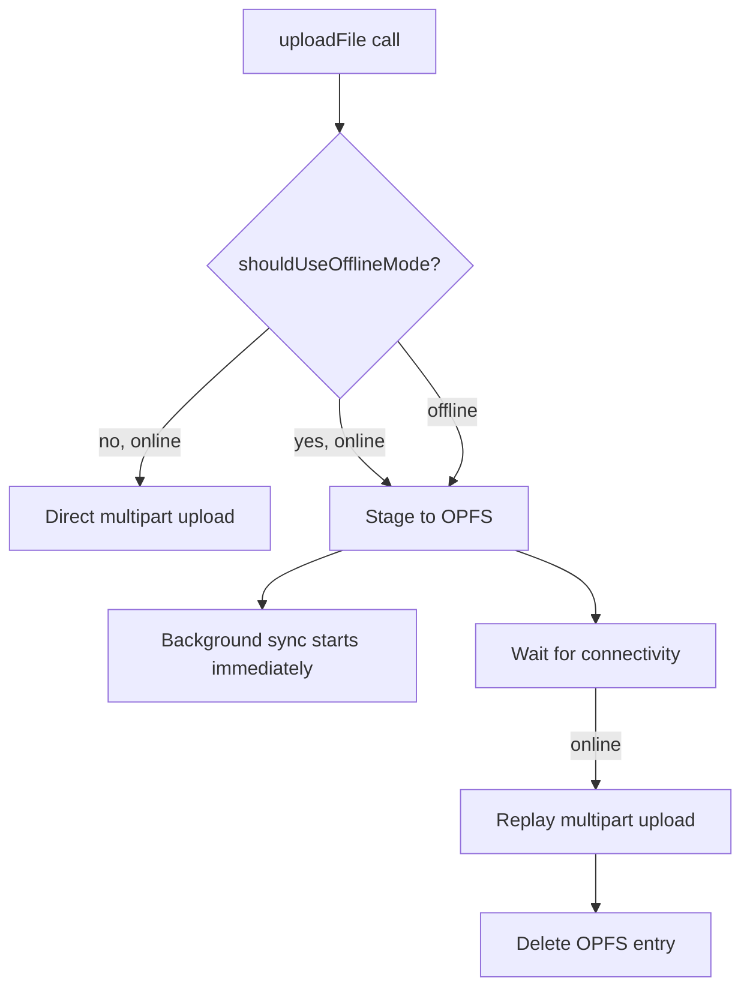

# Offline

`@filefn/client` ships an optional offline pipeline that:

- Stages uploads in the browser's [OPFS (Origin Private File System)](https://web.dev/origin-private-file-system/).
- Replays them automatically when the browser reconnects.
- Serves pending-local previews to your UI so the just-picked file shows up immediately.
- Survives page reloads.

## Enabling

```ts
import { createFileFnClient } from "@filefn/client";

const client = createFileFnClient({
  baseUrl: "/filefn",
  getAuthHeaders: async () => ({}),
  offline: { enabled: true, partition: { serviceId: "app", principal: { kind: "user", principalId: session.userId } } },
});
```

## What happens on `uploadFile(...)`



The check `shouldUseOfflineMode(true)` defaults to `true` — meaning the client *always* stages to OPFS first, even when online. The replay starts immediately, but the OPFS staging is the source of truth until the upload finishes.

Turn it off with `offline: { enabled: false }`, or check `client.getOfflineQueue().capabilities()` and fall back to the direct path when it is not `durable`.

## The pending-local descriptor

When a file is staged but not yet uploaded:

```ts
const renderable = await client.resolveRenderable({
  fileId,
  intent: "preview",
  preferLocal: true,
});

// renderable.state === "pending-local"
// renderable.source.mode === "original" // points to a blob: URL
```

This works for images, PDFs, audio, and video. The client picks a preview behaviour per source kind:

- Images → direct preview from OPFS bytes.
- PDFs → direct preview when the browser supports it; otherwise a `pdf-processing` placeholder.
- Audio / video → preview only for the `preview` intent; otherwise a placeholder.
- Anything else → `unsupported-preview` placeholder.

`preferLocal: true` is the magic flag — it tells the resolver to check OPFS first before going to the server.

## OfflineSync

`OfflineSync` drives a client's durable queue: it processes every entry of the client's partition when started and on each `online` event, retrying unconfirmed uploads after `retryDelayMs`. By default the client starts one on its own; with `offline.implicitReplay: false` you own it:

```ts
const sync = client.createOfflineSync();
sync.start();
// on logout or account switch
sync.dispose();
client.dispose();
```

Holds, verification and publication hooks, partitions, limits and crash recovery are specified in [Features › Offline](../features/offline). The `OfflineSync({ store, client })` form over a raw `OPFSStore` is deprecated: it is unscoped and does not use the queue's locks or journal.

## When offline mode is the wrong choice

OPFS is a write-once store with quota constraints. Don't enable offline mode for very large file workflows (multi-GB videos) on browsers that don't grant generous quota. Detect the quota with `navigator.storage.estimate()` and fall back to direct upload when it would overflow.

## HEIC preprocessing

When `preprocessing.heic.enabled` (default `true`), HEIC inputs are transcoded to JPEG before being staged to OPFS. The OPFS row stores the *output* JPEG, so when sync runs the original HEIC is never re-converted.

## Native parity

The Swift client's `FileFnBackgroundUploader` is the same idea: persisted snapshots, automatic recovery, asset-handle previews. The shape of the persisted state (URL-only, no tokens, no absolute paths) is identical, and the WKWebView bridge exposes the same `pending-local` semantics through `filefn-bridge://asset/{handle}/preview` URLs.
