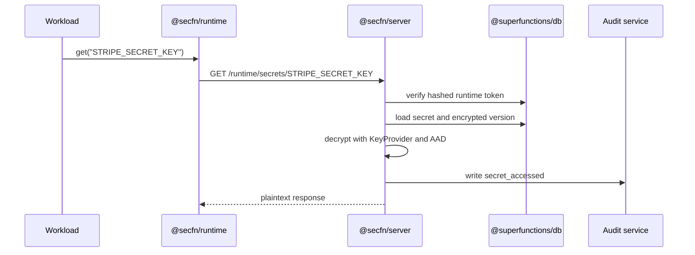

SecFn uses a package split that keeps shared contracts pure and pushes all persistence, routing, and operational behavior into the server package.

## Package Responsibilities

| Layer | Owns | Does Not Own |
| --- | --- | --- |
| `@secfn/core` | Types, errors, schema exports, encryption primitives, scanner rules, reporters, pure helpers. | Database adapters, HTTP routes, service state, framework adapters. |
| `@secfn/server` | Vault service, access service, audit service, rate-limit wrapper, scanner service, HTTP router. | Framework adapter exports, migration execution, browser persistence. |
| `@secfn/runtime` | Read-only runtime client, caching, env materialization helpers. | Admin operations, plaintext disk writes by default, browser secrets. |
| `@secfn/cli` | Source scanning, SARIF output, env pull/run commands. | Production secret persistence. |

## Storage Boundary

Production SecFn storage is always adapter-backed via `@superfunctions/db`. The old local IndexedDB-style helpers are treated as legacy/local helpers and are not the production server path.

`@secfn/core` exports `getSecFnSchema()` so existing Superfunctions schema tooling can discover the required tables:

```ts
import { getSecFnSchema } from "@secfn/core";

const tables = getSecFnSchema();
```

SecFn tables include secrets, versions, sets, service tokens, roles, role bindings, audit events, scan runs, and scan findings.

## Request Flow



## Framework Boundary

SecFn exposes an `@superfunctions/http` router. The host application chooses the adapter:

```ts
import { toExpressHandler } from "@superfunctions/http-express";
import { createSecFnServer } from "@secfn/server";

const secfn = createSecFnServer(config);
app.use("/secfn", toExpressHandler(secfn.router));
```

That keeps SecFn aligned with AuthFn and DataFn patterns and avoids duplicating framework integration code.
