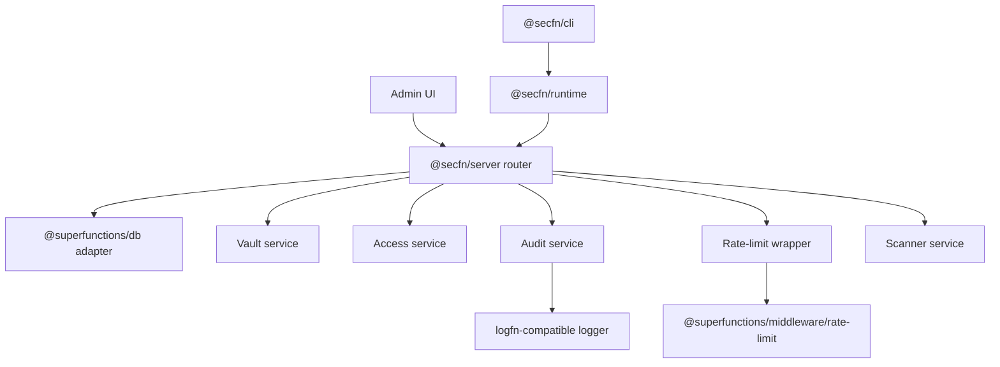

SecFn V1 is the TypeScript-first security layer for Superfunctions. It is split into focused packages so production apps can host their own control plane, consume secrets from server and CI workloads, scan source code, and persist security audit events through the shared `@superfunctions/db` adapter system.

## Packages

| Package | Purpose |
| --- | --- |
| `@secfn/core` | Pure contracts, encryption primitives, scanner rules, RBAC types, audit event types, and schema exports. |
| `@secfn/server` | Adapter-backed vault, admin/runtime router, access checks, rate-limit wrapper, scanner service, and audit service. |
| `@secfn/runtime` | Server, CI, and build-time client for reading runtime secrets and materializing env values. |
| `@secfn/cli` | `secfn scan`, SARIF reporting, env pull, and env run workflows. |
| `@secfn/docs` | This Fumadocs site. |

Python remains an alpha/legacy package for this phase. It is not part of the V1 TypeScript architecture and should not be treated as parity.

## Production Defaults

- Secrets are persisted through `@superfunctions/db`.
- Plaintext is never stored in SecFn tables.
- Runtime tokens are hashed at rest, scoped, environment-aware, and revocable.
- Audit events are durable DB records and may also be mirrored to a compatible logger.
- Rate limiting delegates algorithms and persistence to shared middleware.
- DataFn remains the owner of row, field, resource, sharing, and namespace authorization.

## Architecture

## Next Steps

- [Getting Started](/docs/getting-started)
- [Server Setup](/docs/server-setup)
- [Runtime Secrets](/docs/runtime-secrets)
- [CLI Scanning](/docs/cli-scanning)
- [RBAC With DataFn](/docs/rbac-with-datafn)
- [Security Monitoring With LogFn](/docs/security-monitoring-with-logfn)

----
Part of [Superfunctions](https://github.com/21nCo/super-functions) and built by [21n](https://21n.co).
